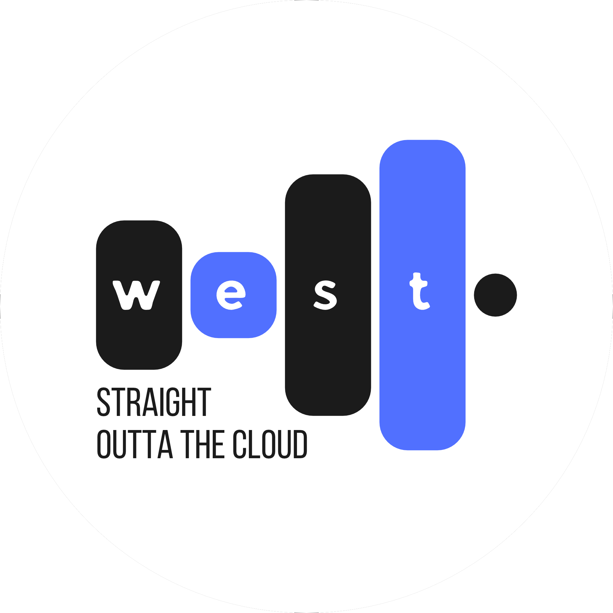
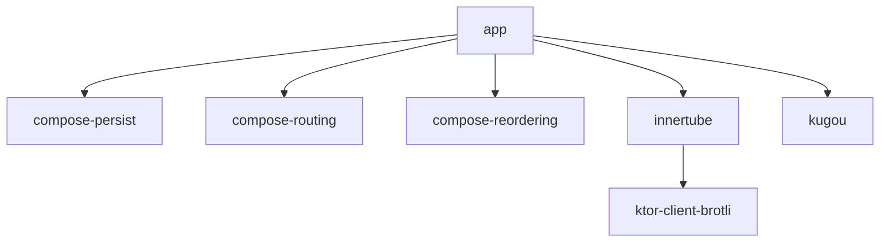
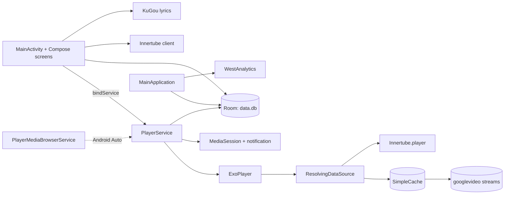
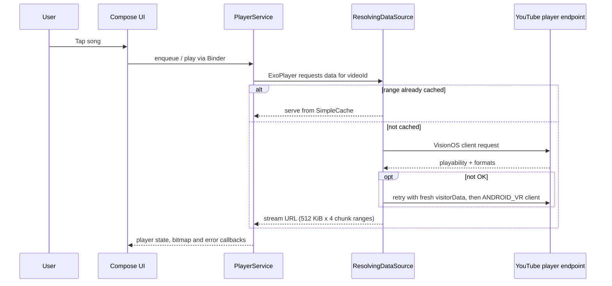

<div align="center">
  
  <h1>WEST</h1>
  <p><b>An Android music client for YouTube Music, forked from ViMusic.</b></p>
</div>

---

## 1. Introduction

WEST is an Android application (Kotlin, Jetpack Compose) that searches and streams music from YouTube Music, with local playlists, a persistent queue, lyrics and an audio cache. It is a modified version of [ViMusic](https://github.com/vfsfitvnm/ViMusic) by vfsfitvnm and contributors, released under GPL-3.0.

> **Naming note.** The repository is `iaaryans/WEST`. The Gradle root project is still named `ViMusic`, and the Kotlin package and application ID are still `it.vfsfitvnm.vimusic`, inherited from upstream. "VIMUSIC" in older notes refers to this same codebase.

The project is beta software; the current release is v0.5.4 (`versionCode 20`). This document describes what is present in the source at commit `8854fbb`. Nothing here was verified by running the app on a device.

## 2. Overview

| Item | Value | Source |
| --- | --- | --- |
| Application ID | `it.vfsfitvnm.vimusic` (`.debug` suffix for debug builds, which is what the v0.5.4 beta APK uses) | `app/build.gradle.kts`, APK manifest |
| Version | 0.5.4 (code 20) | `app/build.gradle.kts` |
| minSdk / targetSdk / compileSdk | 21 / 34 / 34 | `app/build.gradle.kts` |
| Modules | 7 (`app` plus six libraries) | `settings.gradle.kts` |
| Kotlin source files | 192 | `git ls-files` |
| Database | Room, schema version 23 | `app/schemas/.../23.json` |
| License | GPL-3.0 | `LICENSE` |

## 3. Features

Status reflects code inspection only. "Implemented" means a code path exists and is wired to UI or services. It does not mean the feature has been tested against live YouTube responses.

| Feature | Status | Main files |
| --- | --- | --- |
| Search songs, videos, albums, artists, playlists | Implemented | `ui/screens/search/*`, `ui/screens/searchresult/*`, `innertube/.../requests/SearchPage.kt` |
| Search suggestions and local search history | Implemented | `innertube/.../requests/SearchSuggestions.kt`, `OnlineSearch.kt`, `models/SearchQuery.kt` |
| Streaming playback via Media3/ExoPlayer | Implemented, depends on undocumented YouTube behaviour (see Limitations) | `service/PlayerService.kt`, `innertube/.../requests/Player.kt` |
| Background playback, notification, media session | Implemented | `service/PlayerService.kt` |
| Persistent queue (restored on start) | Implemented | `PlayerService.kt` (`maybeRestorePlayerQueue`), `Database.kt` |
| Queue reordering, playlist reordering | Implemented | `compose-reordering/`, `ui/screens/player/Queue.kt`, `LocalPlaylistSongs.kt` |
| Local playlists, favorites, bookmarked albums/artists | Implemented | `Database.kt`, `ui/screens/home/*`, `ui/screens/localplaylist/*` |
| Audio disk cache with size limit | Implemented | `PlayerService.kt` (`SimpleCache`), `enums/ExoPlayerDiskCacheMaxSize.kt`, `CacheSettings.kt` |
| Lyrics: YouTube Music, KuGou synced lyrics, manual editing | Implemented | `ui/screens/player/Lyrics.kt`, `kugou/`, `innertube/.../requests/Lyrics.kt` |
| Sleep timer | Implemented | `PlayerService.kt`, `MediaItemMenu.kt` |
| Skip silence, volume normalization | Implemented | `PlayerService.kt`, `PlayerSettings.kt` |
| Radio / related songs | Implemented | `utils/YoutubeRadio.kt`, `NextPage.kt`, `RelatedPage.kt` |
| Themes: light, dark, dynamic (album-art palette) | Implemented | `ui/styling/*`, `MainActivity.kt`, `androidx.palette` |
| Database backup and restore (file based) | Implemented | `ui/screens/settings/DatabaseSettings.kt` |
| Android Auto media browser | Partially: service exists but is disabled in the manifest and toggled from Settings > Other | `service/PlayerMediaBrowserService.kt`, `OtherSettings.kt` |
| Open YouTube / YouTube Music links | Implemented (intent filters) | `AndroidManifest.xml`, `MainActivity.kt` |
| "Stats for nerds" overlay | Implemented | `ui/screens/player/StatsForNerds.kt` |
| Anonymous usage analytics (Aptabase) | Implemented, enabled in code with no in-app opt-out | `WestAnalytics.kt`, `MainApplication.kt` |
| Offline downloads, account login, automated tests | Not present | none |

## 4. Screenshots

Upstream-derived screenshots exist in `fastlane/metadata/android/en-US/images/phoneScreenshots/` (`1.jpg` to `6.jpg`). They are not embedded here because they may not reflect the current WEST UI. The launcher logo is at `app/src/main/logo.png`.

## 5. Technology stack

Versions are taken from `settings.gradle.kts`, `build.gradle.kts` and module build files.

| Layer | Technology | Version |
| --- | --- | --- |
| Language | Kotlin | 1.7.20 |
| Build | Android Gradle Plugin / Gradle wrapper | 7.3.0 / 7.4 |
| UI | Jetpack Compose (foundation, ui, ripple) | 1.3.0-rc01 (compiler 1.3.2) |
| Activity | `activity-compose` | 1.7.0-alpha01 |
| Images | Coil | 2.2.2 |
| Playback | Media3 ExoPlayer | 1.0.0-beta03 |
| Persistence | Room (kapt) | 2.5.0-beta01 |
| Networking | Ktor client (OkHttp engine), plus `HttpURLConnection` in places | 2.1.2 |
| Serialization | kotlinx.serialization | plugin tied to Kotlin 1.7.20 |
| Concurrency | kotlinx.coroutines | 1.6.4 |
| Misc | Palette 1.0.0, compose-shimmer 1.0.3, Brotli decoder 0.1.2, desugar_jdk_libs 1.1.5 | as listed |
| Not used | Dependency injection framework, Navigation Compose, ViewModel, DataStore | none found |

## 6. Architecture overview

A single-activity app. `MainActivity` hosts all Compose screens and binds to `PlayerService`, a foreground service that owns the `ExoPlayer`, `MediaSession` and the stream cache. UI state lives in composables, `SharedPreferences` and Room `Flow`s. There are no ViewModels or repository classes: screens call the static `Database` DAO and the `Innertube` object directly.

### Module dependencies



### Runtime components



### Playback flow



## 7. Project structure

```
app/                  Application: UI, service, Room database, preferences
  src/main/kotlin/it/vfsfitvnm/vimusic/
    MainActivity.kt, MainApplication.kt, Database.kt
    service/          PlayerService, PlayerMediaBrowserService, BitmapProvider
    ui/               screens, components, items, styling
    models/ enums/ utils/
  schemas/            Exported Room schemas, versions 1 to 23
innertube/            YouTube Music (InnerTube) client, models, parsers
kugou/                KuGou lyrics provider
compose-routing/      Route handling and transitions (from ViMusic)
compose-reordering/   Drag-to-reorder lazy lists (from ViMusic)
compose-persist/      Cross-config-change state persistence (from ViMusic)
ktor-client-brotli/   Brotli content encoding for Ktor
fastlane/metadata/    Store metadata, changelogs, screenshots
.github/workflows/    android.yml (debug build)
```

## 8. How it works

1. `MainApplication.onCreate` initializes the Room database and the analytics helper, and configures the Coil image cache.
2. `MainActivity` binds to `PlayerService`, applies the saved theme, and renders `HomeScreen` plus the bottom-sheet player. Routes are declared in `ui/screens/Routes.kt`.
3. Browsing and search call `Innertube` request functions (`innertube/.../requests/`), whose response models are parsed into `Innertube.*Item` types.
4. Playing an item hands a Media3 `MediaItem` to the service. Stream URLs are resolved lazily in `createDataSourceFactory()` and cached in `SimpleCache`.
5. Playback statistics, queue contents, formats and lyrics are stored in Room.

## 9. Prerequisites

- JDK 17 (used by CI, `.github/workflows/android.yml`)
- Android SDK with platform 34 and build-tools 34.0.0 (as stated by the previous README; not independently checked)
- Network access to Google Maven, Maven Central, JitPack, and the Gradle distribution host

## 10. Build and run

```bash
git clone https://github.com/iaaryans/WEST.git
cd WEST
./gradlew assembleDebug        # app/build/outputs/apk/debug/app-debug.apk
./gradlew assembleRelease      # needs a release keystore, see below
```

CI runs `./gradlew assembleDebug` only. These commands match the repository's workflow; no build was executed while writing this document.

The Gradle wrapper downloads Gradle 7.4 from a Tencent Cloud mirror (`gradle/wrapper/gradle-wrapper.properties`) with no checksum pin. If that host is unreachable, edit the URL locally.

Install the debug APK with `adb install app/build/outputs/apk/debug/app-debug.apk`, or open the project in Android Studio and run the `app` configuration.

## 11. Configuration

- **Release signing:** `app/build.gradle.kts` signs release builds only if `release.keystore` exists in the repository root. Provide `KEYSTORE_PASSWORD`, `KEY_ALIAS` and `KEY_PASSWORD` as environment variables. Keystores are git-ignored. See TECHNICAL_AUDIT.md finding H-1 about insecure fallback values in that file.
- **Analytics:** controlled by the `WestAnalytics.initialize(...)` call in `MainApplication.kt`. Remove that call to build without telemetry.
- **Runtime settings** (stored in `SharedPreferences`, keys in `utils/Preferences.kt`): theme, thumbnail roundness, cache sizes, loop modes, skip silence, normalization, persistent queue, Android Auto toggle, invincibility mode.

## 12. Permissions

| Permission | Purpose |
| --- | --- |
| `INTERNET` | Streaming, metadata, lyrics, analytics |
| `FOREGROUND_SERVICE`, `FOREGROUND_SERVICE_MEDIA_PLAYBACK` | Playback service (declared type `mediaPlayback`) |
| `POST_NOTIFICATIONS` | Declared; no runtime request was found in the code (see audit M-3) |
| `WAKE_LOCK` | Keep playing with screen off |
| `REQUEST_IGNORE_BATTERY_OPTIMIZATIONS` | Optional "invincibility" mode, requested from Settings > Other |

`allowBackup` is `false`.

## 13. Testing

There is no meaningful test coverage. `innertube/src/test/kotlin/Test.kt` and `kugou/src/test/kotlin/Test.kt` each contain an empty JUnit 4 test, and `app/` has no `test` or `androidTest` directory. CI does not run tests or lint.

## 14. Release and deployment

Release builds enable R8 minification and resource shrinking (`app/build.gradle.kts`, `app/proguard-rules.pro`) and the build can emit a universal APK. Distribution is manual through GitHub Releases; no store publishing is configured.

The current release is **v0.5.4** (`versionName 0.5.4`, `versionCode 20`), published as a **debug-build beta**:

| Property | Value |
| --- | --- |
| File | `West-v0.5.4-beta.apk` |
| Size | 11,785,120 bytes (about 11.8 MB) |
| SHA-256 | `98e4a8170a5d008953c65961782a46331e8f606ecf787183dc95bf07cee850c2` |
| Package | `it.vfsfitvnm.vimusic.debug` |
| Build type | Debug: `debuggable=true`, not minified, signed with the Android debug certificate |
| minSdk / targetSdk | 21 / 34 |

Verify the download with `sha256sum West-v0.5.4-beta.apk`. Because the package ID has the `.debug` suffix, the beta installs as a separate app and can coexist with ViMusic. A future release-signed build (`it.vfsfitvnm.vimusic`) will be a different app with its own data; use Settings > Database to back up and restore your library. Android will ask you to allow installs from your browser or file manager.

## 15. Security and privacy

- Playlists, history, queue and caches are stored locally in the app's private storage.
- Requests go directly to YouTube/Google hosts, KuGou, and Aptabase (EU).
- **Analytics are active in the current source.** `MainApplication.kt` initializes `WestAnalytics` with an embedded app key, and events `app_started` and `song_played` are sent with device model, OS version, app version, locale and a per-session ID. There is no in-app switch.
- Debug-level logs include a prefix of resolved stream URLs (`PlayerService.kt`).
- Details and other findings: [TECHNICAL_AUDIT.md](./TECHNICAL_AUDIT.md).

## 16. Current limitations

- Playback relies on impersonating YouTube VisionOS and Android VR clients with hard-coded versions; changes on YouTube's side can break it without notice.
- Toolchain and libraries are old, and several are pre-release (see section 5).
- No automated tests; large classes such as `PlayerService.kt` (1,027 lines) and `Database.kt` (684 lines).
- The Kotlin package and release application ID still use the upstream name (`it.vfsfitvnm.vimusic`). A future release-signed build cannot be installed over a ViMusic build signed with another key. The current debug beta uses the `.debug` suffix and does not have this conflict.
- The distributed beta APK is a debug build: larger, unoptimized, debuggable, and signed with the Android debug key.
- Unofficial client; not affiliated with or endorsed by YouTube or Google.

## 17. Contributing

1. Fork and branch (`git checkout -b fix/short-description`).
2. Keep changes focused and state the device and Android version you tested on.
3. Open a pull request. Contributions are accepted under GPL-3.0.

Bug reports use the template in `.github/ISSUE_TEMPLATE/bug_report.yaml`.

## 18. License

GPL-3.0, see [`LICENSE`](./LICENSE). WEST contains code by vfsfitvnm and ViMusic contributors, whose copyrights remain with them.

## 19. Acknowledgements

- [ViMusic](https://github.com/vfsfitvnm/ViMusic) by vfsfitvnm and contributors, the basis of this project.
- Libraries listed in section 5.
