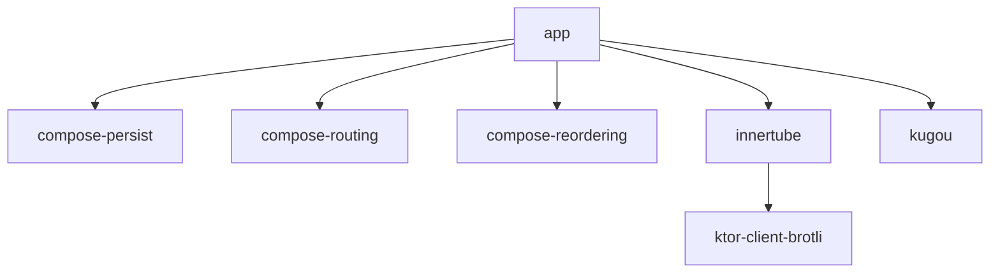
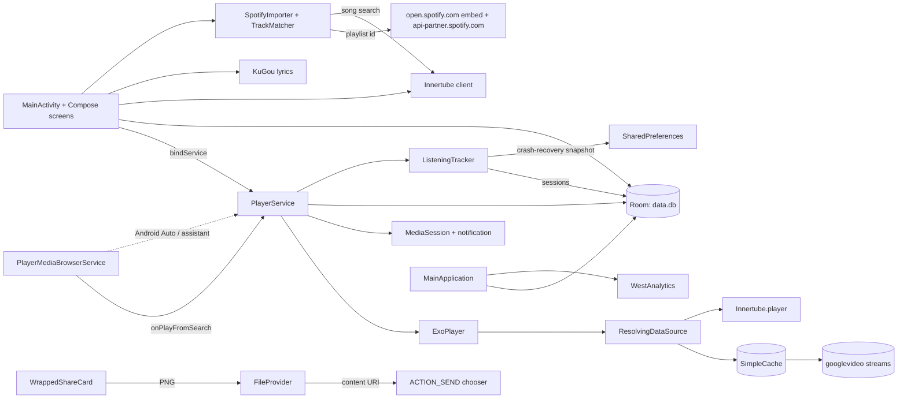
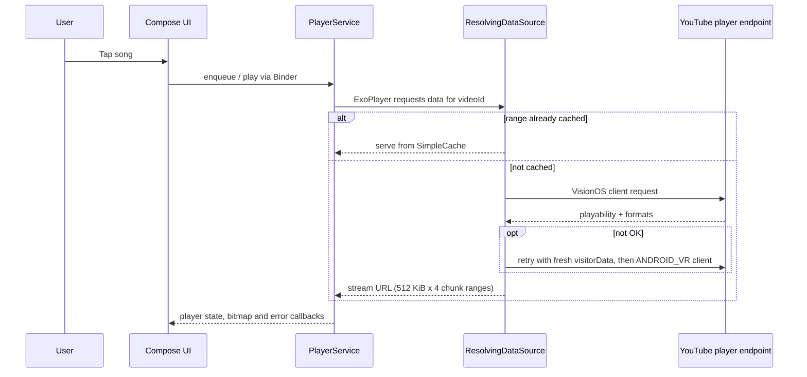
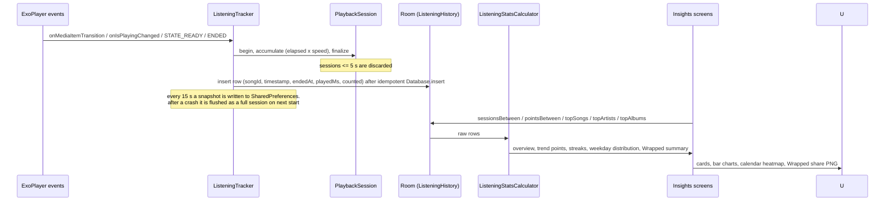
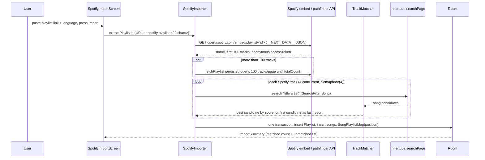

<div align="center">
  <picture>
    <source media="(prefers-color-scheme: dark)" srcset="./app/src/main/res/drawable-nodpi/west_logo_full_light.png" />
    <source media="(prefers-color-scheme: light)" srcset="./app/src/main/res/drawable-nodpi/west_logo_full_dark.png" />
    
  </picture>
  <p><b>An Android music client for YouTube Music, forked from ViMusic.</b></p>
</div>

---

## 1. Introduction

WEST is an Android music client built with Kotlin and Jetpack Compose. It uses YouTube Music discovery and streaming, local playlists, a persistent Media3/ExoPlayer queue, lyrics, audio caching, and WEST-specific discovery and personalization features. WEST descends from [ViMusic](https://github.com/vfsfitvnm/ViMusic) and retains the applicable upstream copyright and GPL-3.0 obligations.

**Repository and naming.** Development in this contribution takes place at [adarsh01-cyber/WEST](https://github.com/adarsh01-cyber/WEST) on `west-e2e-update`; the [upstream contribution PR](https://github.com/iaaryans/WEST/pull/2) targets `iaaryans/WEST:main`. The Gradle root project is named `WEST`. The inherited Kotlin package and base application ID remain `it.vfsfitvnm.vimusic`; they are identifiers, not a second product name. Debug variants can append `.debug` or, with `-PwestPreview`, `.preview`.

**Documentation baseline (24 November 2026).** Sections 1–19 describe the current `west-e2e-update` source, not every historical beta or ZIP. The source still declares `versionName 0.5.4` and `versionCode 20`; this is not a claim that a new production release has been published. Section 20 and its dated notes preserve older implementation history and must not override current source, build, or CI facts. “Implemented” below means there is a wired code path; it does **not** certify successful operation with live upstream services on every device.

## 2. Overview

| Item | Current source value | Source |
| --- | --- | --- |
| Product / Gradle root project | WEST | `settings.gradle.kts` |
| Base application ID / namespace | `it.vfsfitvnm.vimusic` | `app/build.gradle.kts` |
| Debug application IDs | `it.vfsfitvnm.vimusic.debug` normally; `it.vfsfitvnm.vimusic.preview` with `-PwestPreview` | `app/build.gradle.kts` |
| Source version | `0.5.4` (`versionCode 20`) | `app/build.gradle.kts` |
| minSdk / targetSdk / compileSdk | 21 / 34 / 34 | `app/build.gradle.kts` |
| Toolchain | JDK 17, Android Gradle Plugin 7.3.0, Gradle wrapper 7.4 | Build files and CI |
| Gradle modules | 7 (`app` and six support libraries) | `settings.gradle.kts` |
| Database | Room, schema version 24 | `app/schemas/`, `Database.kt` |
| License | GPL-3.0 | `LICENSE` |
| Main navigation | Home → Moodspace → Search → Library | `ui/screens/home/HomeScreen.kt` |

Source counts, class line counts, APK sizes, and test totals from older revisions are intentionally not treated as fixed project properties: they change when code or build configurations change.

## 3. Features

The table describes **features wired in this source branch**, not a full device-level acceptance test. “Limited” identifies documented scope or dependencies. Online discovery and playback depend on third-party services and connectivity.

| Feature area | Current implementation and limitations | Representative source |
| --- | --- | --- |
| Four-tab navigation | Home, Moodspace, Search, Library; Library has Playlists / Songs / Artists / Albums | `ui/screens/home/HomeScreen.kt` |
| Home discovery | Quick picks, recents, personalized shelves, artist/album/playlist discovery and shortcuts; Moodspace is a separate tab, not a duplicated Home section | `ui/screens/home/QuickPicks.kt`, `HomeShelfPolicy.kt` |
| WEST Intelligence | On-device, heuristic recommendations using taste selections, listening, favorites and feedback; no trained/cloud-hosted LLM | `intelligence/RecommendationEngine.kt`, `RecommendationRepository.kt` |
| First-launch personalization | Skippable language, searchable-artist, song and mood preference selection; taste stored locally, editable/resettable | `personalization/TasteProfile.kt`, `PersonalizationOnboardingScreen.kt` |
| Moodspace Explore | Two-column browse categories, online shelves/playlists, fallback categories, personalized song queries and playback; catalog contents depend on provider responses | `ui/screens/home/MoodspaceScreen.kt`, `MoodspaceCatalog.kt`, `innertube/.../MoodExplore.kt` |
| Timed mixes | Duration-bounded mixes assembled from available library songs, with remix/ending options; requires eligible local library content | `ui/screens/home/MixScreen.kt`, `TimedMix.kt` |
| Search | Online catalog search, suggestions, saved/recent/pinned queries, library search, listening-history search and smart discovery/filtering | `ui/screens/search/`, `ui/screens/searchresult/` |
| Search safety | Centralized query submission, saved-history navigation handling and keyboard/IME regression coverage | `SearchSubmission.kt`, `app/src/androidTest/.../SearchNavigationTest.kt` |
| WEST Voice | Push-to-talk **music query input** using Android speech recognition; does not expose a general voice assistant or voice-controlled playback commands through this dialog | `voice/VoiceSearchDialog.kt`, `voice/VoiceMusicQuery.kt` |
| Android media search integration | Separate `onPlayFromSearch` integration for MediaSession / media browser; limited by device and service availability | `service/PlayerService.kt`, `PlayerMediaBrowserService.kt` |
| Hybrid Smart Queue | Playing a search result seeds a bounded queue; Smart Continue can fetch/rank related candidates, preserve selected/visible result ordering and handle Next/Previous | `service/PlayerService.kt`, `intelligence/SmartQueueRanker.kt` |
| Playback | Media3/ExoPlayer streaming, background service, media notification, queue persistence, reordering, seek/skip, sleep timer | `service/PlayerService.kt`, `ui/screens/player/` |
| Immersive player | Expanded playback surface with artwork and animated controls, plus reduced-motion support | `ui/screens/player/ImmersivePlayerDialog.kt`, `ui/screens/settings/AppearanceSettings.kt` |
| Artwork / browsing performance | Size-aware artwork requests, shared browse caches, time-bounded LRU policies and scroll-aware deferred artwork work; **not** a guarantee of zero jank | `ui/performance/HomeArtworkPolicy.kt`, `MusicBrowseCache.kt`, `ui/screens/home/MoodspaceScreen.kt` |
| Local library | Favorites, local playlists, albums/artists, library reordering and playlist import entry points | `Database.kt`, `ui/screens/home/HomePlaylists.kt`, `ui/screens/localplaylist/` |
| Spotify import | Public-playlist link import and track matching to catalog results, with review/unmatched-item handling; unofficial Spotify endpoints can change | `spotify/SpotifyImporter.kt`, `TrackMatcher.kt`, `ui/screens/spotify/SpotifyImportScreen.kt` |
| Listening Insights / WEST Wrapped | Recorded listening sessions, trends, streaks, top tracks/artists/albums, calendar heatmap and shareable annual summary | `listening/` |
| Lyrics | YouTube Music lyrics, KuGou synchronized lyrics where available, and manual edits | `ui/screens/player/Lyrics.kt`, `kugou/` |
| Audio cache and offline | Configurable audio cache; offline playlist playback can use **fully cached** tracks. This is **not** a managed offline-download or permanent-download system | `service/PlayerService.kt`, `ui/screens/localplaylist/OfflinePlaylistAction.kt` |
| UI settings | Light/dark/dynamic palettes, artwork shapes, animation/reduced-motion preferences, playback settings | `ui/styling/`, `ui/screens/settings/` |
| Data portability | Local Room database backup and restore | `ui/screens/settings/DatabaseSettings.kt` |
| Android TV / Auto | TV launcher declarations and a configurable media browser; not a claim of a TV-optimized interface or fully certified Android Auto experience | `AndroidManifest.xml`, `PlayerMediaBrowserService.kt` |
| Telemetry | Aptabase-compatible anonymous events are initialized in source without an in-app opt-out | `utils/WestAnalytics.kt`, `MainApplication.kt` |
| Accounts / permanent downloads | No account sign-in or managed permanent music download feature established by the current source | — |

**Scope warning:** Moodspace recommends music from chosen categories and taste signals; it does not infer actual emotions or perform acoustic mood classification. WEST Intelligence similarly uses local ranking heuristics rather than model training.

## 4. Screenshots

Existing `fastlane/metadata/android/en-US/images/phoneScreenshots/` screenshots originate from an older UI and should **not** be presented as proof of the current Home, Moodspace, onboarding or immersive-player design. Capture new device screenshots before publishing store or release marketing material.

Current WEST logo/wordmark resources are in `app/src/main/res/drawable-nodpi/` (including light- and dark-theme variants); launcher assets live in `app/src/main/res/mipmap-*/`. The repository may also retain an older `app/src/main/logo.png` source image.

## 5. Technology stack

Versions are taken from the Gradle build files in this branch; some dependencies are legacy or prerelease. The wrapper currently uses the official `services.gradle.org` Gradle 7.4 distribution.

| Layer | Technology | Version |
| --- | --- | --- |
| Language | Kotlin | 1.7.20 |
| Build | Android Gradle Plugin / Gradle wrapper | 7.3.0 / 7.4 |
| UI | Jetpack Compose (foundation, ui, ripple) | 1.3.0-rc01 (compiler 1.3.2) |
| Activity | `activity-compose` | 1.7.0-alpha01 |
| Images | Coil | 2.2.2 |
| Playback | Media3 ExoPlayer | 1.0.0-beta03 |
| Persistence | Room (kapt) | 2.5.0-beta01 |
| Networking | Ktor client (OkHttp engine), plus `HttpURLConnection` in places | 2.1.2 |
| Serialization | kotlinx.serialization | plugin tied to Kotlin 1.7.20 |
| Concurrency | kotlinx.coroutines | 1.6.4 |
| Misc | Palette 1.0.0, compose-shimmer 1.0.3, Brotli decoder 0.1.2, desugar_jdk_libs 1.1.5 | as listed |
| Test-only | JUnit 4.13.2, `org.json:json` 20220320 (real JSON parser for importer tests), `org.xerial:sqlite-jdbc` 3.42.0.0 (real SQLite engine for migration tests) | `app/build.gradle.kts` |
| Not used | Dependency injection framework, Navigation Compose, ViewModel (androidx), DataStore | none found |

The three test-only dependencies are `testImplementation` scoped and are not packaged into the APK. `org.json:json` exists because the Android `org.json` stub throws on the JVM, and the Spotify importer's parsing is exactly what its tests exercise; `sqlite-jdbc` lets the Room 23→24 migration be executed against a real SQLite engine in `From23To24MigrationTest`.

## 6. Architecture overview

A single-activity app. `MainActivity` hosts all Compose screens and binds to `PlayerService`, a foreground service that owns the `ExoPlayer`, `MediaSession` and the stream cache. UI state lives in composables, `SharedPreferences` and Room `Flow`s. There are no androidx ViewModels or repository classes in the main app: screens call the static `Database` DAO and the `Innertube` object directly. The one deliberate exception is `ListeningStatsViewModel` in the listening module — a plain state holder created with `remember` and torn down in a `DisposableEffect`, used because the Insights screen combines five data streams that should survive recomposition but not configuration-light rotation handling androidx would provide; it is not an `androidx.lifecycle.ViewModel`.

Representative feature areas include:

- **`listening/`** (inside the `app` module, package `it.vfsfitvnm.vimusic.listening`) is layered as `tracker/` → `data/` → `domain/` → `presentation/` + `components/`. The tracker listens to the player; the data layer owns the Room entity/DAO/migration and a statistics calculator that is pure Kotlin (unit-testable on the JVM); the presentation layer renders six screens. It never modifies player configuration.
- **`spotify/`** (package `it.vfsfitvnm.vimusic.spotify`) holds the importer and matcher as pure Kotlin (networking via `HttpURLConnection`, matching via the existing `Innertube.searchPage`), with `ui/screens/spotify/SpotifyImportScreen.kt` as the only UI surface.

- **`intelligence/` and `personalization/`** implement taste profiles, heuristic recommendations, listening-based ranking and Hybrid Smart Queue scoring. The queue coordinator is integrated into the existing `PlayerService`, not a second playback service.
- **`moodspace/`, `ui/screens/home/MoodspaceScreen.kt` and `innertube/requests/MoodExplore.kt`** compose a browse-category interface using live provider shelves with local fallback categories; `ui/performance/MusicBrowseCache.kt` caches responses and throttles artwork lookups.
- **`voice/`** supplies speech-to-text **music search** through Android's recognition APIs and forwards normalized queries into the ordinary Search flow. It is distinct from the media browser's `onPlayFromSearch` integration.
- **Home/UI performance helpers** (`ui/performance/`, `ui/screens/home/HomeShelfPolicy.kt`) reduce repeated provider requests and excessive artwork work during scrolling. Their tests exercise policies, not measured end-to-end frame-rate guarantees.

### Module dependencies



Unchanged from the previous revision; both new features live inside the `app` module and do not add modules. `app` additionally has test-only dependencies on JUnit, `org.json` and `sqlite-jdbc` (section 5).

### Runtime components



### Playback flow



Unchanged in this revision; the listening tracker observes the same player without altering resolution or caching.

### Listening statistics data flow (new)



### Spotify import flow (new)



## 7. Project structure

```
app/                          Application: UI, service, Room database, preferences
  src/main/kotlin/it/vfsfitvnm/vimusic/
    MainActivity.kt, MainApplication.kt, Database.kt
    service/                  PlayerService, PlayerMediaBrowserService, BitmapProvider
    listening/                NEW: listening statistics, layered in isolation
      tracker/                ListeningTracker, PlaybackSession (player-event capture)
      data/                   ListeningHistoryEntity/Dao, ListeningMigrations (23→24),
                              ListeningStatsCalculator, ListeningStatsRepository,
                              ListeningSettings, ListeningMediaItems
      domain/                 ListeningPeriod, ListeningStats (+ duration formatters)
      presentation/           ListeningStatsViewModel, ListeningInsightsScreen,
                              TopSongs/TopArtists/TopAlbumsScreen, ListeningCalendarScreen,
                              WestWrappedScreen, WrappedShareCard, WrappedCardPalette
      components/             CalendarHeatmap, ListeningChart, StatsCard, TopTrackItem
    spotify/                  NEW: SpotifyImporter (embed page + pathfinder pagination),
                              TrackMatcher (scoring engine)
    ui/                       screens (home, search, player, settings, spotify, ...),
                              components, items, styling
    models/ enums/ utils/     incl. utils/WestAnalytics.kt
  src/test/kotlin/            NEW: JVM unit tests (section 13)
  schemas/                    Exported Room schemas, versions 1 to 24
  src/main/res/xml/           file_paths.xml (NEW, share cards), automotive_app_desc.xml
  src/main/res/values-v29/    NEW: themes with enforceNavigationBarContrast (API 29+)
innertube/                    YouTube Music (InnerTube) client, models, parsers
  src/test/kotlin/            NEW: MusicResponsiveListItemRendererMappingTest (+ old empty Test.kt)
kugou/                        KuGou lyrics provider
compose-routing/              Route handling and transitions (from ViMusic)
compose-reordering/           Drag-to-reorder lazy lists (from ViMusic)
compose-persist/              Cross-config-change state persistence (from ViMusic)
ktor-client-brotli/           Brotli content encoding for Ktor
fastlane/metadata/            Store metadata, changelogs 9–20, screenshots
.github/workflows/            android.yml (JDK 17, assembleDebug, APK artifact)
```

Routes are declared in `ui/screens/Routes.kt` and near feature screens. The current Home host shows **four bottom tabs (Home, Moodspace, Search, Library)**; the Library tab contains Playlists, Songs, Artists and Albums. `MoodspaceScreen` supplies category subpages within the Moodspace tab. `listeningStatsRoute` and `spotifyImportRoute` are wired into the Home route handler, with entry points from Home/Library. See `ui/screens/home/HomeScreen.kt` for the authoritative navigation wiring.

## 8. How it works

1. `MainApplication.onCreate` initializes the Room database and the analytics helper, and configures the Coil image cache.
2. `MainActivity` binds to `PlayerService`, applies the saved theme, and renders `HomeScreen` plus the bottom-sheet player. Routes are declared in `ui/screens/Routes.kt`, plus the two feature-local routes listed in section 7. When the player bottom sheet is fully expanded, its underlying `HomeScreen` subtree is marked `invisibleToUser()` for TalkBack (added in this revision).
3. Browsing and search call `Innertube` request functions (`innertube/.../requests/`), whose response models are parsed into `Innertube.*Item` types. Search-result rows are now mapped structurally (artists = runs that browse to `MUSIC_PAGE_TYPE_ARTIST`, album = album/browse runs, duration = the first `m:ss`-shaped run) instead of by fixed column position, which fixes corrupted artist/duration metadata on several YouTube Music row layouts.
4. Playing an item hands a Media3 `MediaItem` to the service. Stream URLs are resolved lazily in `createDataSourceFactory()` and cached in `SimpleCache`.
5. Queue contents, formats and lyrics are stored in Room. Every finished playback of at least five seconds is additionally recorded as a listening session (step 6).
6. **Listening statistics.** `ListeningTracker` (a `Player.Listener` registered in `PlayerService.onCreate`, shut down in `onDestroy`) turns player events into `PlaybackSession`s: time is accumulated only while playing, scaled by playback speed, and never inflated by seeks. A finalized session is written to the `ListeningHistory` table (created by the Room 23→24 migration, which also backfills from the legacy `Event` table) after an idempotent `Database.insert(mediaItem)` guarantees the song/artist/album foreign keys exist. A 15-second heartbeat persists an in-flight snapshot so a process death loses at most that much; on the next start it is recovered in one transaction that also increments the song's total play time. The Insights dashboard reads the table through `ListeningStatsRepository` Flows and computes overview/trend/streak/ranking data in `ListeningStatsCalculator`.
7. **Spotify import.** `SpotifyImporter` validates the link, fetches the public Spotify embed page and parses its `__NEXT_DATA__` JSON for the playlist name, the first 100 tracks and an anonymous access token; longer playlists are paginated through Spotify's web-player persisted-query API at 100 tracks per page. Each track is searched on YouTube Music via `Innertube.searchPage`, scored by `TrackMatcher` (title core, version markers, artist, duration, album, explicit flag; hard gates on title and duration), and the playlist is written in a single transaction so it can never be half-created.
8. Voice search ("play … on WEST") arrives at `PlayerMediaBrowserService` or the `PlayerService` session callback, whose `onPlayFromSearch` (new in this revision) plays the top 50 local search hits, or the 50 most-played songs for a blank query; with no results it simply resumes.

9. **WEST Intelligence and onboarding.** `TasteProfileStore` persists optional artist/song/language/mood selections. `RecommendationRepository` combines those selections with local library and listening signals; the results are heuristic shelves, not externally trained predictions.
10. **Moodspace.** The app draws cached or fallback categories immediately, then loads provider categories/shelves when reachable. Artwork prefetch is postponed during active list scrolling; category-specific search results can be personalized by stored tastes.
11. **Hybrid Smart Queue.** Search playback initializes an ordered queue. When enabled, related-track discovery and ranking add candidates asynchronously; a user Next tap should not require manually reopening search.
12. **Voice search.** The in-app microphone opens `VoiceSearchDialog` and submits recognized text as a normal Search query. This does not implement arbitrary spoken device commands.

## 9. Prerequisites

- **JDK 17** (used by `.github/workflows/android.yml`; older Gradle/AGP versions are not a JDK 21 upgrade target without additional work).
- **Android SDK platform 34**, **build-tools 34.0.0**, and platform tools; emulator or physical device only when executing connected instrumentation tests.
- Access to `services.gradle.org` for the wrapper and to Google Maven, Maven Central and JitPack for dependencies. The current wrapper URL is `https://services.gradle.org/distributions/gradle-7.4-bin.zip`.
- An Android SDK location via git-ignored `local.properties` (`sdk.dir=...`) or `ANDROID_HOME` / `ANDROID_SDK_ROOT`.

No paid service, Spotify account, or model-training infrastructure is required to build the source. External catalog endpoints remain subject to their providers' availability and terms.

## 10. Build and run

Clone the repository or use an existing checkout. For this contribution branch:

```bash
git clone https://github.com/adarsh01-cyber/WEST.git
cd WEST
git switch west-e2e-update
./gradlew --no-daemon -PwestPreview :app:testDebugUnitTest :innertube:test :kugou:test :app:lintDebug :app:assembleDebug
```

Windows PowerShell equivalents use `.\gradlew.bat` instead of `./gradlew`. `-PwestPreview` produces the `.preview` application-ID suffix; omitting it uses the normal debug suffix. Find the compiled artifact(s) under `app/build/outputs/apk/debug/`. For a device connected through ADB, install the **actual output filename** reported by the build.

**Verified CI baseline (24 November 2026):** The pull-request workflow [WEST - Build and Verify APK, run 45452354244](https://github.com/iaaryans/WEST/actions/runs/45452354244) completed successfully for commit `0f12f3d`. It passed Android SDK setup, mandatory JVM regression tasks, Android lint, `app:assembleDebug`, APK signature/label/integrity and the workflow's size threshold (**greater than 25,000,000 bytes**), then uploaded a `WEST-Verified-Build` artifact containing the packaged APK and source archive. The GitHub run is evidence for **that commit and configuration**, not blanket runtime certification.

**Instrumentation boundary:** `reactivecircus/android-emulator-runner` is **manual-only** (`workflow_dispatch`) because the hosted emulator timed out in a prior run. It was **skipped** in the successful PR run. To run instrumentation yourself, boot an Android emulator or connect a device and execute `./gradlew -PwestPreview :app:connectedDebugAndroidTest`; do not mark tests as passed without the resulting report.

The `assembleRelease` task may produce an **unsigned** APK without a configured signing key; it is not an automatically installable or published release. See section 11 for signing precautions. A large APK is only a packaging requirement, not a quality metric.

## 11. Configuration

- **Release signing:** `app/build.gradle.kts` signs release builds only if `release.keystore` exists in the repository root. Provide `KEYSTORE_PASSWORD`, `KEY_ALIAS` and `KEY_PASSWORD` as environment variables. Keystores are git-ignored. The script still contains hard-coded fallback values for those environment variables — an insecure pattern carried over from an earlier revision (formerly documented in the repository's technical audit, which is no longer shipped — see section 15); override them via the environment when signing releases.
- **Analytics:** controlled by the `WestAnalytics.initialize(...)` call in `MainApplication.kt`. Remove that call to build without telemetry.
- **Listening statistics** (new): the play-count threshold lives in SharedPreferences under the key `listeningPlayCountThresholdMs` (15 s / 30 s / 60 s choices, default 30 s), editable from the Insights screen; a track counts as "played" when the threshold is reached, capped at half the track's duration. The tracker itself has no opt-out — it records whenever `PlayerService` runs.
- **Runtime settings** (stored in `SharedPreferences`, keys in `utils/Preferences.kt`): theme, thumbnail roundness, cache sizes, loop modes, skip silence, normalization, persistent queue, Android Auto toggle, invincibility mode.

- **Onboarding and intelligence:** artist/song/language/mood selections are persisted by `personalization/TasteProfile.kt`; recommendation preferences and feedback live under `intelligence/`. These are device-local preferences, not a remote learning model.
- **Smart Continue and motion:** Smart Queue continuation can be toggled, and the UI contains reduced-motion and artwork/presentation settings. Exact keys and defaults are defined in the source; do not assume historical preference names are stable.

## 12. Permissions

Key manifest permissions and their intended purposes:

| Permission | Purpose |
| --- | --- |
| `INTERNET` | Streaming, metadata, lyrics, analytics, Spotify import |
| `FOREGROUND_SERVICE`, `FOREGROUND_SERVICE_MEDIA_PLAYBACK` | Playback service (declared type `mediaPlayback`) |
| `POST_NOTIFICATIONS` | Declared; no runtime request was found in the code |
| `WAKE_LOCK` | Keep playing with screen off |
| `REQUEST_IGNORE_BATTERY_OPTIMIZATIONS` | Optional "invincibility" mode, requested from Settings > Other |

`allowBackup` is `false`. Two manifest-level additions are not permissions but affect how the app is surfaced:

- A **FileProvider** (`${applicationId}.fileprovider`, paths from `res/xml/file_paths.xml`) exposes only the app's `cacheDir/shared/` folder so the WEST Wrapped card can be shared as a PNG with `ACTION_SEND`.
- `uses-feature` declarations for `android.hardware.touchscreen` and `android.software.leanback` (both `required="false"`), plus the `LEANBACK_LAUNCHER` category, make Android TV a valid target; and the media browser service gained a `android.media.action.MEDIA_PLAY_FROM_SEARCH` intent filter so assistants can invoke voice search.

## 13. Testing

Both JVM tests and Android instrumentation test sources are present. Their presence does **not** imply that every device or live-service flow has been tested.

| Coverage area | Representative tests | Latest PR CI |
| --- | --- | --- |
| Spotify import and track matching | `SpotifyImporterTest`, `TrackMatcherTest` | JVM test tasks passed |
| Listening statistics, migration and Wrapped | `From23To24MigrationTest`, `PlaybackSessionTest`, `ListeningStatsCalculatorTest`, `WrappedCardPaletteTest` | JVM test tasks passed |
| WEST Intelligence and Hybrid Smart Queue ranking | `RecommendationEngineTest`, `SmartQueueRankerTest` | JVM test tasks passed |
| Moodspace and timed mixes | `MoodspaceCatalogTest`, `MoodspaceSafetyTest`, `MoodMixEngineTest`, `TimedMixTest`, `MoodExploreParserTest` | JVM test tasks passed |
| Search submission, discovery and history bounds | `SearchSubmissionTest`, `DiscoveryTest`, `HistoryBoundsTest` | JVM test tasks passed |
| Browse performance and artwork policies | `HomeArtworkPolicyTest`, `TimedLruCacheTest`, `HomeShelfPolicyTest`, `MoodArtworkPrefetchPolicyTest` | JVM test tasks passed |
| Search navigation / crash regression | `app/src/androidTest/.../SearchNavigationTest.kt` | Source present; **not executed** in successful PR CI |
| Hybrid playback / Home scroll smoke tests | `HybridSmartQueuePlaybackTest`, `FrameTimingScrollSmokeTest`, `HomeMoodspaceScrollRegressionTest` | Source present; **not executed** in successful PR CI |

On 24 November 2026, [run 45452354244](https://github.com/iaaryans/WEST/actions/runs/45452354244) finished successfully: `:app:testDebugUnitTest`, `:innertube:test`, `:kugou:test`, lint, APK compilation, verification and artifact upload passed. The workflow's emulator step is explicitly restricted to manual dispatch and was skipped on the pull request. Older counts such as “113 tests” in historical revision notes are not a current exhaustive total.

Suggested local check:

```bash
./gradlew --no-daemon -PwestPreview :app:testDebugUnitTest :innertube:test :kugou:test :app:lintDebug :app:assembleDebug
```

For live playback, UI smoothness, search/queue navigation and crash regressions, supplement unit tests with a real device or a working emulator and publish the test conditions and results. **No 60 FPS, no-crash or full-E2E guarantee is claimed.**

## 14. Release and deployment

The source still declares `versionName 0.5.4` / `versionCode 20`. The historical `West-v0.5.4-beta.apk` and its checksums belong to an earlier distributed debug beta, **not** the current `west-e2e-update` build.

| Distribution channel | Current status |
| --- | --- |
| GitHub Actions pull-request run | [Verified run 45452354244](https://github.com/iaaryans/WEST/actions/runs/45452354244), commit `0f12f3d` |
| CI build artifact | `WEST-Verified-Build`; includes packaged `WEST.apk` and source archive, subject to GitHub artifact retention |
| CI package validation | Integrity, APK signature, WEST application label and **size >25,000,000 bytes** passed on that run |
| Instrumentation tests | Skipped on normal PR checks; manual workflow only |
| Public release / Play Store | No newly published production release is established by CI success |
| Release signing | Requires a properly configured keystore; unsigned release outputs are not installable as production releases |

The `-PwestPreview` debug variant uses `it.vfsfitvnm.vimusic.preview`, which is separate from the older `.debug` beta and from the inherited release ID. These package variants do not automatically share application data. Back up/restore the library using the application's settings when migrating if supported and compatible.

**Historical beta reference (not the current CI artifact):** `West-v0.5.4-beta.apk` was documented at 11,785,120 bytes and SHA-256 `98e4a8170a5d008953c65961782a46331e8f606ecf787183dc95bf07cee850c2`. Retained only to identify the earlier release, not to describe the new APK.

## 15. Security and privacy

- Playlists, history, queue, caches and the listening statistics are stored locally in the app's private storage. The listening tracker additionally keeps a crash-recovery snapshot of the current session in the app's `SharedPreferences`.
- Requests go directly to YouTube/Google hosts, KuGou, and Aptabase (EU); the Spotify import feature additionally contacts `open.spotify.com` (embed page) and `api-partner.spotify.com` (playlist pagination) with the playlist ID from the user's link.
- **Analytics are active in the current source.** `MainApplication.kt` initializes `WestAnalytics` (a hand-rolled Aptabase-compatible client) with an embedded app key, and events `app_started` and `song_played` are sent with device model, OS version, app version, locale and a per-session ID. There is no in-app switch; network failures are silently ignored.
- **Listening statistics are always on** — sessions are recorded whenever the player service runs. There is no opt-out; clearing the data or uninstalling removes the history.
- Debug-level logs include a prefix of resolved stream URLs (`PlayerService.kt`).
- The repository no longer ships `TECHNICAL_AUDIT.md` (the previous README linked to it). The findings it documented that were fixed in this revision are annotated in code comments with their audit identifiers (`BUG-001`, `BUG-002`, `BUG-004`, `BUG-008`, `MissingOnPlayFromSearch`, `MissingIntentFilterForMediaSearch`) and are listed in section 20. Open items remain: no runtime `POST_NOTIFICATIONS` request, analytics without opt-out, and the signing-credential fallback values in `app/build.gradle.kts`.

## 16. Current limitations

- **Device-level verification is incomplete.** The successful PR workflow passes JVM tests, Android lint, APK compilation and packaging, but skips emulator instrumentation. Search/queue behavior, UI frame pacing and stability across devices still require connected tests and measured traces.
- **No absolute smoothness claim.** Scroll-aware caching, artwork sizing and deferred prefetch are implemented, but “zero lag,” “always 60 FPS,” or exact parity with another app is not established by source review or a green build.
- **External service fragility.** Unofficial YouTube Music playback/discovery clients and Spotify public-playlist parsing depend on undocumented behavior and may break when upstream services change. Spotify import does not include private playlist OAuth.
- **Heuristic personalization only.** Intelligence uses local preference/listening/feedback signals, not a remote LLM, trained recommender, emotional-state detection or audio-mood classifier.
- **Offline scope.** A cache and playback of completely cached tracks are provided, not a managed permanent offline-download system. Initial online Moodspace categories, artwork and recommendations require network access.
- **Older platform dependencies.** The project uses AGP 7.3.0, Gradle 7.4 and several prerelease libraries; upgrades require regression testing.
- **Application identity.** The inherited `it.vfsfitvnm.vimusic` package cannot be treated as a distinct release identity without considering signatures, installed variants and data migration.
- **UI surfaces.** Android TV manifest support and Android Auto media-service integration do not mean fully optimized or certified TV/vehicle experiences.
- **Listening / telemetry privacy.** Listening history and telemetry behavior require deliberate privacy review; the source documents no in-app opt-out for existing anonymous Aptabase events.
- **Release safety.** Existing signing-credential fallbacks in `app/build.gradle.kts` should be removed before any production distribution. Never commit keystores or production secrets.
- Unofficial application: WEST is not affiliated with or endorsed by YouTube, Google or Spotify.

## 17. Contributing

1. Fork and branch (`git checkout -b fix/short-description`).
2. Keep changes focused and state the device and Android version you tested on.
3. Open a pull request. Contributions are accepted under GPL-3.0.

Bug reports use `.github/ISSUE_TEMPLATE/bug_report.yaml`. Contributors should run the mandatory JVM tests, lint and debug build, and include emulator/device evidence when changing navigation, playback, UI smoothness or crash-sensitive flows. Do not report instrumentation tests as passing when they were skipped.

## 18. License

GPL-3.0, see [`LICENSE`](./LICENSE). WEST contains code by vfsfitvnm and ViMusic contributors, whose copyrights remain with them.

## 19. Acknowledgements

- [ViMusic](https://github.com/vfsfitvnm/ViMusic) by vfsfitvnm and contributors, the basis of this project.
- Spotify playlist import and matching implementation (existing behaviour retained).
- Home and Moodspace visual inspirations/adaptations are accompanied by source-attribution notes in `HOME-EXPLORE-ATTRIBUTION.txt` and `MOODSPACE-EXPLORE-ATTRIBUTION.txt`; preserve applicable GPL notices and copyright credits.
- Libraries listed in section 5.

## 20. Revision notes — what changed since the previous README

> **Historical change log.** This section records work leading to the earlier beta/source revisions and retains its original sequencing. It is not the current feature inventory or test report; use sections 2–3 and 10–14 for the source and CI status as of 24 November 2026.

The previous README documented the baseline source. This revision's source tree adds two feature commits and a fix batch; everything below was verified against that final source.

### Added

| Change | Where |
| --- | --- |
| **Listening statistics module** (isolated): tracker, Room table + 23→24 migration with legacy-data backfill, statistics calculator, repository, Insights dashboard (Overview / Songs / Artists / Albums / Calendar / Wrapped), calendar heatmap, top-10/20/50 rankings with play-from-rank, WEST Wrapped annual summary with 9:16 PNG share card via FileProvider | `listening/` (23 files), `Database.kt` (version 24), `AndroidManifest.xml`, `res/xml/file_paths.xml` |
| **Spotify playlist import** : public-playlist embed-page fetch, pathfinder pagination past 100 tracks, score-based YouTube Music matching, transactional playlist creation, unmatched-track summary, language filter | `spotify/SpotifyImporter.kt`, `spotify/TrackMatcher.kt`, `ui/screens/spotify/SpotifyImportScreen.kt`, `res/drawable/spotify_logo.xml` |
| Voice search via `onPlayFromSearch` in both the player service and the media browser service (local library; blank query = 50 most-played songs) | `service/PlayerService.kt`, `service/PlayerMediaBrowserService.kt`, `AndroidManifest.xml` |
| Android TV declarations: `LEANBACK_LAUNCHER` launcher category, optional `touchscreen`/`leanback` features, TV banner already present | `AndroidManifest.xml` |
| "Insights" sidebar entry (new home navigation item); "Import from Spotify" tile on the Playlists tab with a Spotify logo drawable | `ui/screens/home/HomeScreen.kt`, `ui/screens/home/HomePlaylists.kt` |
| Unit test suite (8 classes, section 13) and its three test-only dependencies | `app/src/test/`, `innertube/src/test/`, `app/build.gradle.kts` |

### Fixed

| Bug | What was wrong | Fix |
| --- | --- | --- |
| Metadata corruption in InnerTube row parsing | `FromMusicResponsiveListItemRenderer` read fixed column positions; several YouTube Music layouts (merged byline, album/playlist shelves, legacy 3-column) yielded swapped artists or play counts stored as durations | Structural run classification (artist page-type runs, album/browse runs, first `m:ss` run); `FromMusicShelfRendererContent` now delegates to it; artist names joined with `", "` in `asMediaItem` (`utils/Utils.kt`) |
| BUG-001: all-time trend crash | Yearly trend iterated from year 1970 to the `Long.MAX_VALUE` all-time bound → OutOfMemoryError | Year bounds derived from the data (capped at 500 years); regression tests added |
| BUG-002: Wrapped share-card contrast | Light themes produced unreadable cards | `WrappedCardPalette` derives WCAG-contrast-checked colors (dark themes pass through; light themes get an accent-derived dark gradient with light text); tested |
| BUG-004: hardware Enter in search | Physical keyboards inserted a newline instead of submitting | `onPreviewKeyEvent` intercepts Enter / numpad Enter (`OnlineSearch.kt`) |
| BUG-008: TalkBack reaching hidden controls | Player sheet content focusable behind the expanded sheet | `invisibleToUser()` semantics on the covered `HomeScreen` subtree when the sheet is fully expanded (`MainActivity.kt`) |
| MissingOnPlayFromSearch | Voice search had no handler | Implemented in both services (see Added) |
| MissingIntentFilterForMediaSearch | Media browser service not reachable via `MEDIA_PLAY_FROM_SEARCH` | Intent filter added to `PlayerMediaBrowserService` in the manifest |
| Build/lint: `enforceNavigationBarContrast` under minSdk 21 | API-29-only attribute in base themes | Attribute moved to new `values-v29/` and `values-night-v29/` theme overlays |
| Crash-recovery play time | Recovered sessions were written but the song's total play time was not incremented (songs could vanish from "Songs") | Recovery now runs in one transaction and calls `Database.incrementTotalPlayTimeMs` (`ListeningTracker.kt`) |

### Changed / removed

- The listening **History tab was removed** (and `ListeningHistoryScreen.kt` with its DAO/repository support deleted); Insights now has six tabs with no history list. The tracker still records everything.
- The old Insights entry point (trending icon button on Quick picks) was removed in favour of the sidebar item; the Spotify import UI gained header text buttons → grid tiles and a compact toolbar.
- `formatListeningDuration` renders compact pure days/hours ("2d", "1h") and plural forms are shared via `formatPlural`.

### Documentation

- This README is a continuation of the previous one: structure, numbering, terminology and the identity/history notes above are preserved; sections 2–8, 9–13 and 15–16 were updated against the final source; the two new data-flow diagrams were added; the dead `TECHNICAL_AUDIT.md` references were replaced with inline notes (the file is no longer in the repository).
- Version, application ID, toolchain and permission facts were re-verified against the source; the debug APK and unit tests were actually built/run for this revision (sections 10, 13, 14).


**Historical appendices.** The dated 22 November entries below preserve their original development context. Status statements about unavailable SDKs, unbuilt APKs, missing Git remotes, test counts, and the then-current ZIP are **archival**, not the status of this GitHub branch on 24 November. The successful CI run and its instrumentation-test exception are documented above.

**Archived WEST source addendum (22 November 2026; historical snapshot).** The preceding numbered sections and their original content are retained for historical context. Some statements above describe an earlier beta rather than the source and workflow in this archive; the facts below supersede those older statements when they conflict.

| Current property | Verified in this source archive |
| --- | --- |
| Project branding | Gradle root project is `WEST` (`settings.gradle.kts`), not the historical `ViMusic` name. The upstream Kotlin package and base application ID remain `it.vfsfitvnm.vimusic`. |
| Developers and repository profile | WEST credits Aaryan and Adarsh. Adarsh's GitHub profile is [adarsh01-cyber](https://github.com/adarsh01-cyber). A GitHub remote is **not** configured in the bundled local Git repository; set it to your chosen WEST repository before pushing. |
| Maintained navigation | Home → Moodspace → Search → Library; the Library contains playlists, songs, artists and albums. |
| WEST Intelligence | On-device heuristic recommendations, discovery slider, feedback actions (`More like this` / `Less`), and feedback reset. This is **not** a cloud-hosted LLM or a trained predictive model. |
| Moodspace | Dedicated bottom tab (Home → Moodspace → Search → Library); selectable mood cards (Happy, Sad, Chill, Focus, Workout, Relax, Sleep, Night Drive, Travel, Energetic, Melancholy, Custom); preloaded online mood-query recommendations **before any songs are added**; optional WEST Intelligence personalization based on the user's real listening, favorites and feedback; local recommendations and artist-based related tracks after song addition; search/add/play/save timed mixes. Recommendations refresh when the preferred artist changes or when Remix is tapped. This does **not** detect the listener's emotional state or analyze audio mood; an internet connection is required for initial online mood discovery. |
| Timed Mix | Create approximately time-bounded mixes using library songs, optionally with a selected ending and remix action. |
| Search extensions | Local and online results, smart filtering, pinned and recent queries, listening-time/history search, microphone-based query input, and search-submit handling. On-device search regression tests cover history selection and keyboard Search. |
| Player experience | Immersive player, animated song/artwork/control transitions, queue persistence and restoration code, and a reduced-motion setting. |
| Import and statistics | Spotify public-playlist import with candidate review controls; listening Insights, WEST Wrapped summary, and shareable presentation. |
| GitHub Actions workflow | JVM tests, Android lint, debug APK, integrity/signature/label and **size greater than 25,000,000 bytes** are mandatory in normal PR CI. Emulator instrumentation is **manual-dispatch only** in the current workflow; it was skipped in the successful 24 November run. |
| Historical ZIP binary | An earlier ZIP carried `apk/WEST-Final.apk`; this does **not** describe the GitHub checkout. Build and release artifacts are delivered by the current CI workflow; Git ignores `*.apk`. |
| Source hygiene | `README.md` is the primary project guide; additional attribution and validation documentation can exist in source. Preserve copyright attributions, and keep `gradlew` executable on Unix. |

**Current build handoff:** Use JDK 17, Android SDK Platform 34 and `./gradlew --no-daemon -PwestPreview :app:testDebugUnitTest :innertube:test :kugou:test :app:lintDebug :app:assembleDebug`. The `.preview` suffix is used for preview builds. PR CI ran successfully on 24 November; run `:app:connectedDebugAndroidTest` separately on an emulator or device and inspect its result before making full-E2E claims. Size >25 MB is a packaging threshold, not proof of quality.

**Remaining cautions:** This README's earlier release-size tables, test counts, feature descriptions, and original repository naming are historical. The bundled source still has upstream application ID and legacy toolchain constraints, as well as signing fallback credentials in `app/build.gradle.kts`. Do not publish a real release signing key, password, or keystore in Git; review signing configuration and privacy settings before production distribution. Fastlane screenshots in `fastlane/metadata/` may be outdated and should be replaced with captures of the actual WEST UI before store submission.


**WEST Intelligence 2.0 — first-launch taste onboarding (22 November 2026; additive update).** The numbered README sections above remain unchanged. This source includes a new full-screen first-launch flow with optional Skip: languages → searchable artist picker with visible popular circular artist cards and live catalog artwork → optional favorite songs → Moodspace preferences → confirmation. Popular artists are a short initial seed, not a claim that every musician is hardcoded; search uses the existing InnerTube artist endpoint. Artist photos are fetched from the service and rendered via Coil; when unavailable, a music-note fallback is shown.

| New capability | Source implementation |
| --- | --- |
| First-launch gating and reopen from Settings → Privacy & history | `MainActivity.kt`, `ui/screens/settings/OtherSettings.kt` |
| Taste choices saved privately to local SharedPreferences; reset and Skip supported | `personalization/TasteProfile.kt` |
| Popular artist photo cards and live search, optional song search | `personalization/PersonalizationOnboardingScreen.kt`, `personalization/ArtistCatalog.kt` |
| Cold-start recommendations on Home from chosen artists/languages/songs and personalized Moodspace discovery | `ui/screens/home/TasteDiscoverySection.kt`, `ui/screens/home/QuickPicks.kt`, `ui/screens/home/MoodspaceScreen.kt` |
| Library ranking seeded from explicitly selected songs/artists; continues learning from real listening and favorites | `intelligence/RecommendationEngine.kt`, `intelligence/RecommendationRepository.kt` |
| Ranking regression tests for onboarding artist/song preferences | `app/src/test/kotlin/it/vfsfitvnm/vimusic/intelligence/RecommendationEngineTest.kt` |

**Historical local validation:** this onboarding change was initially inspected without a working Android SDK. **Later status:** [GitHub Actions run 45452354244](https://github.com/iaaryans/WEST/actions/runs/45452354244) successfully built and packaged commit `0f12f3d` after JVM tests and lint; emulator instrumentation was skipped, so real-device functionality is not certified. New artist/song discovery needs internet access and a working upstream music catalog; this is not a trained LLM and does not infer real emotional state or acoustic mood.

**WEST Hybrid Smart Queue 1.0 (22 November 2026; additive update, original README sections preserved).** Search playback no longer intentionally begins as an isolated track when other loaded results are available. Tapping a song in normal Search results, saved search previews, online previews, local Search, intelligent Search, or listening-history Search now creates a bounded queue beginning with the chosen song, then later search results. The pre-existing queue editor, player, scrubbing controls, and MediaSession remain in place; there is no second audio player.

- `service/PlayerService.kt`: `Binder.playSmartQueue` builds the initial queue synchronously; related-track discovery runs asynchronously, uses generation checks to discard stale requests, deduplicates loaded tracks, and refills only when the active queue is near its end. `skipToNextOrDiscover` honors a Next tap made before a single-song queue's recommendations have arrived (one pending skip per generation). Next actions from the main player, controls, immersive view, notification and media browser route through the same coordinator.
- `intelligence/SmartQueueRanker.kt`: deterministic, testable hybrid queue policy. The already-loaded search results stay in user-facing order; **only auto-discovered radio candidates** are re-ranked using selected artists/songs, favorites, recorded listening, recent-play penalties, More/Less feedback, and the existing discovery preference. No fabricated audio mood or new subscription/server is implied. A music-provider response and network connection are still needed to discover online suggestions.
- `utils/Player.kt`: a lone item is no longer restarted when the user presses Next; normal queue navigation and explicit repeat behavior remain. UI queue options expose **Smart Continue: on/off**, persisted under `westSmartContinueEnabled`. The Up Next panel shows a loading explanation while songs are being fetched.
- `app/src/test/.../intelligence/SmartQueueRankerTest.kt`: pure ranking, ordering, deduplication, personalization, and edge-case regression tests. `app/src/androidTest/.../service/HybridSmartQueuePlaybackTest.kt`: Media3 one-song/multiple-song Next/Previous checks. Existing Search navigation instrumentation now bypasses the unrelated first-run onboarding screen when checking history and keyboard-search crash regressions.

**Validation boundary:** The pure Kotlin queue policy compiled and its 12 standalone assertions passed. At the time of this dated note, a local environment could not download Gradle and did not have an Android SDK, so that isolated check could not compile the app. **Later status:** GitHub Actions passed the JVM suite, lint, APK build and packaging on 24 November (run 45452354244); instrumentation was skipped on PR CI, and connected-device runtime validation remains unconfirmed. Run `.github/workflows/android.yml` in a connected CI environment and examine all failures before publishing an APK. This source ZIP intentionally contains **no APK**. The former README structure and existing files are retained.
