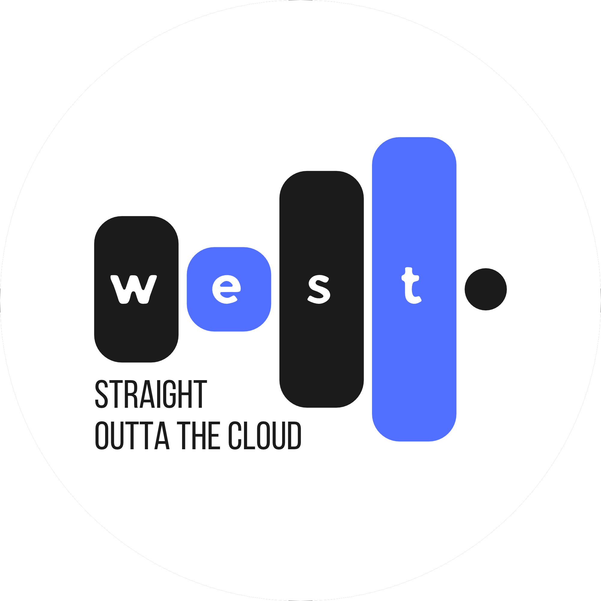

<div align="center">
  
  <h1>WEST</h1>
  <p><b>Straight Outta The Cloud.</b></p>
  <p>An independently branded Android music player for YouTube Music, reworked from <a href="https://github.com/vfsfitvnm/ViMusic">ViMusic</a>.</p>
  <p>
    
    
    
  </p>
</div>

---

## About

WEST is a modified version of [ViMusic](https://github.com/vfsfitvnm/ViMusic) by [vfsfitvnm](https://github.com/vfsfitvnm) and contributors. The original app had parts that stopped working reliably (songs failing to play, album and artist pages not loading), so WEST reworks those areas and ships under its own name, logo and signing key.

WEST is **beta software**. It is under active development, has not been tested on every device, and nothing here should be read as a guarantee that every song will play.

> WEST is a derivative work. The original ViMusic code remains the work of its authors and is licensed under the GNU GPL v3, as is WEST. See [License and attribution](#license-and-attribution).

## What WEST changes

Compared with the ViMusic snapshot it was based on, the repository currently contains:

| Area | Change |
| --- | --- |
| Playback | Rewritten stream-resolution step in `innertube/.../requests/Player.kt`: tries a VisionOS client first (with visitor data refresh on `LOGIN_REQUIRED`), then falls back to an Android VR client. Extra logging in `PlayerService`. |
| Browsing | Updated InnerTube parsers and models for albums, artists, playlists and related music (`requests/*Page.kt`, `models/*`, `utils/From*Renderer.kt`). |
| Android 13/14+ | Dynamic broadcast receivers registered with `RECEIVER_NOT_EXPORTED`; `FOREGROUND_SERVICE_MEDIA_PLAYBACK` permission; `compileSdk`/`targetSdk` 34; `allowBackup` disabled. |
| Identity | New name, launcher icons and logo, About screen, release signing configuration. |
| Telemetry | Optional-by-key anonymous usage events via Aptabase (see [Privacy](#privacy)). |
| CI | GitHub Actions workflow building the debug APK. |

Everything else is inherited from ViMusic unchanged.

## Features

These features exist in the current source. Most are inherited from ViMusic; they are listed here as *present*, not as individually re-tested on every release.

- Search YouTube Music for songs, albums, artists, videos and playlists
- Background playback with a notification and media controls
- Persistent queue, queue and playlist reordering
- Local playlists, bookmarked artists and albums
- Lyrics (including synchronized lyrics) with editing
- Audio cache for repeat playback
- Sleep timer, skip silence, audio normalization
- Light, dark and dynamic themes
- Android Auto media-browser service
- Opening YouTube / YouTube Music links

## Download

The APK is available from the WEST website (add your site URL here) and from the repository's releases once one is published for it.

| | |
| --- | --- |
| File | `West-Release.apk` (2.6 MB) |
| SHA-256 | `948068e841ec5decb87ab8fb3140ea7810529201351e6ace90102391dae4d532` |
| Source | [tag `v1.0.0`](https://github.com/iaaryans/WEST/tree/v1.0.0) |

Verify the download with `sha256sum West-Release.apk`. Because the APK is installed outside an app store, Android will ask you to allow installs from your browser or file manager.

## Privacy

- WEST has no ads and no account system.
- Audio and metadata are requested directly from YouTube / YouTube Music.
- Playlists, bookmarks, queue and cache are stored on your device.
- **The current build sends anonymous usage events to [Aptabase](https://aptabase.com) (EU region).** Events: `app_started` and `song_played`, together with device model, Android version, app version, locale and a random per-session ID. See [`WestAnalytics.kt`](./app/src/main/kotlin/it/vfsfitvnm/vimusic/utils/WestAnalytics.kt). Analytics are only active when a valid app key is passed to `WestAnalytics.initialize` in `MainApplication.kt`; remove that call to build without them.

## Build from source

Requirements: JDK 17, Android SDK (API 34, build-tools 34.0.0).

```bash
git clone https://github.com/iaaryans/WEST.git
cd WEST

./gradlew assembleDebug      # debug APK
./gradlew assembleRelease    # release APK (needs your own keystore, see below)
```

APKs are written to `app/build/outputs/apk/`.

### Release signing

`app/build.gradle.kts` signs release builds when a `release.keystore` file exists in the repository root. Provide credentials through the `KEYSTORE_PASSWORD`, `KEY_ALIAS` and `KEY_PASSWORD` environment variables. Never commit a keystore or its passwords.

## Project layout

```
app/                 Android application (Jetpack Compose, Media3/ExoPlayer, Room)
innertube/           YouTube Music (InnerTube) client and parsers
kugou/               Lyrics provider
compose-persist/     State persistence helpers (from ViMusic)
compose-reordering/  Drag-and-drop reordering (from ViMusic)
compose-routing/     Navigation (from ViMusic)
ktor-client-brotli/  Brotli support for Ktor (from ViMusic)
```

The Kotlin package and application id are still `it.vfsfitvnm.vimusic`, inherited from ViMusic. Installing WEST therefore conflicts with an installed ViMusic build signed with a different key.

## Contributing

Bug reports and pull requests are welcome.

1. Fork the repository and create a branch (`git checkout -b fix/short-description`).
2. Keep changes focused and mention which device / Android version you tested on.
3. Open a pull request. Contributions are accepted under GPL-3.0.

## License and attribution

- WEST is licensed under the **GNU General Public License v3.0**. The full text is in [`LICENSE`](./LICENSE).
- It is a modified version of **ViMusic** by vfsfitvnm and contributors. The original authors retain their respective copyrights in the original code. WEST's modifications are by Aaryan (2026) and are recorded in the [commit history](https://github.com/iaaryans/WEST/commits/main).
- Additional credits are in [`NOTICE.md`](./NOTICE.md).

WEST is not affiliated with, funded, authorized or endorsed by YouTube, Google LLC, the ViMusic maintainers, or any of their affiliates. All trademarks belong to their respective owners.
