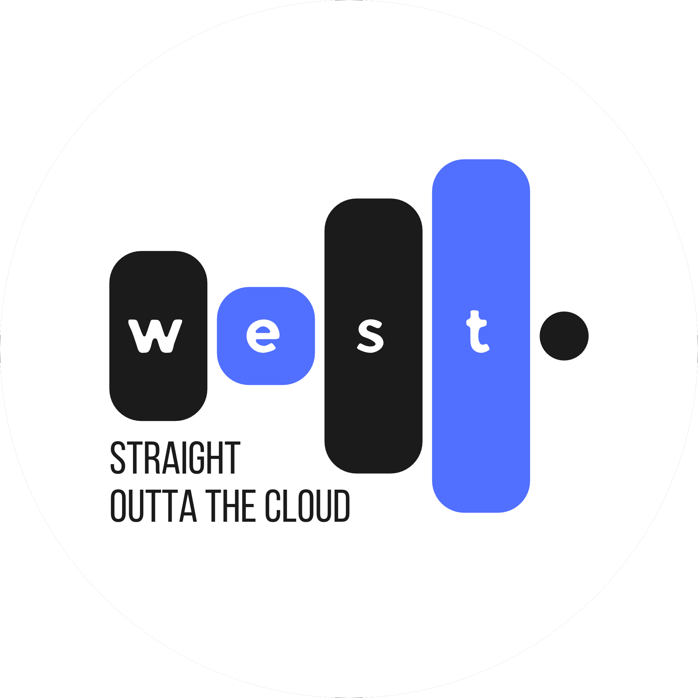
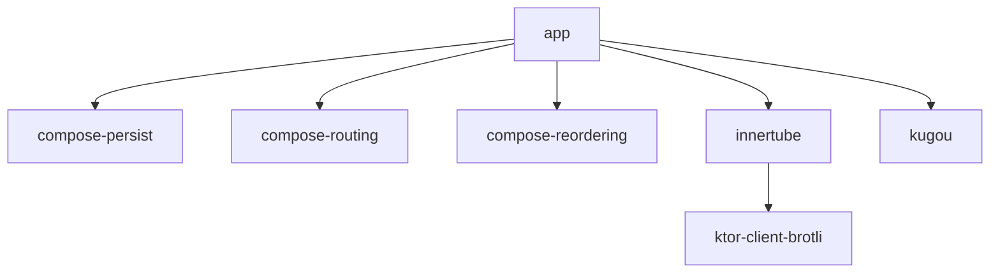
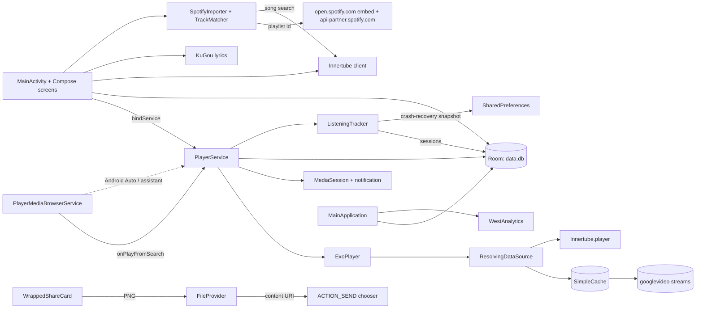
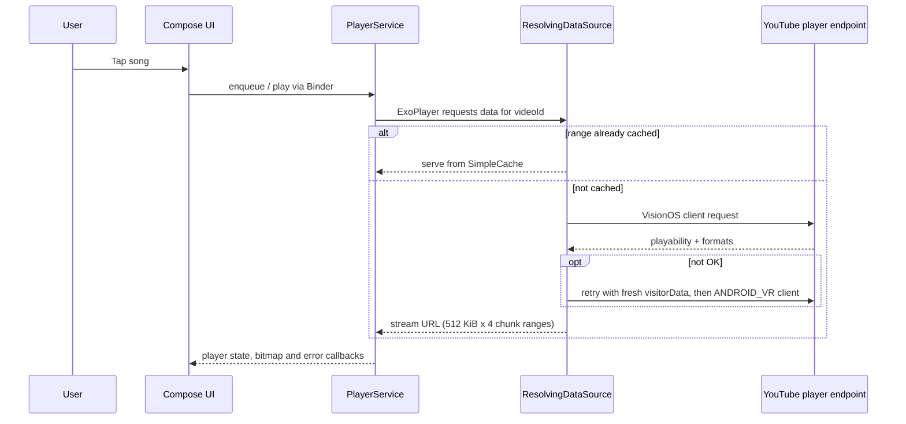
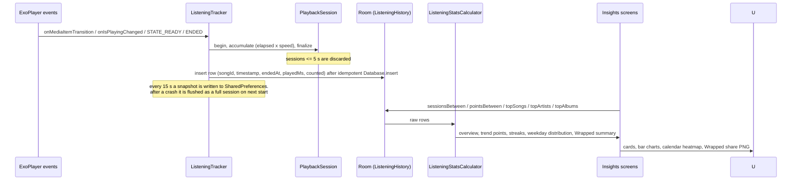
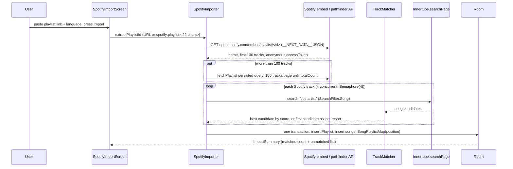

<div align="center">
  
  <h1>WEST</h1>
  <p><b>An Android music client for YouTube Music, forked from ViMusic.</b></p>
</div>

---

## 1. Introduction

WEST is an Android application (Kotlin, Jetpack Compose) that searches and streams music from YouTube Music, with local playlists, a persistent queue, lyrics and an audio cache. It is a modified version of [ViMusic](https://github.com/vfsfitvnm/ViMusic) by vfsfitvnm and contributors, released under GPL-3.0.

> **Naming note.** The repository is `iaaryans/WEST`. The Gradle root project is still named `ViMusic`, and the Kotlin package and application ID are still `it.vfsfitvnm.vimusic`, inherited from upstream. "VIMUSIC" in older notes refers to this same codebase.

The project is beta software; the current release is v0.5.4 (`versionCode 20`).

**About this revision.** This document is a continuation of the previous WEST README, updated against the final fixed source tree. Since the previous revision (which described the baseline at commit `8854fbb`), the source gained three commits — `3bfb2ca` ("WEST-main baseline (unmodified)"), `8dd1cc4` ("Integrate Spotify playlist import") and `4bcb969` ("Add advanced listening statistics (isolated listening module)") — plus a final, uncommitted fix batch on top of `4bcb969` that repairs a metadata-parsing bug in the InnerTube module, a crash risk in the all-time trend calculation, contrast problems in the Wrapped share card, hardware-keyboard search submission, screen-reader behaviour, and adds voice search. All of this is part of the source shipped here; section 20 lists every change in detail. Unlike the previous revision, the debug APK and the unit test suite were actually built and run while preparing this document (see sections 10 and 13 for the concrete results).

## 2. Overview

| Item | Value | Source |
| --- | --- | --- |
| Application ID | `it.vfsfitvnm.vimusic` (`.debug` suffix for debug builds, which is what the v0.5.4 beta APK uses) | `app/build.gradle.kts`, APK manifest |
| Version | 0.5.4 (code 20) | `app/build.gradle.kts` |
| minSdk / targetSdk / compileSdk | 21 / 34 / 34 | `app/build.gradle.kts` |
| Modules | 7 (`app` plus six libraries) | `settings.gradle.kts` |
| Kotlin source files | 227 on disk: 224 tracked (one of which, `ListeningHistoryScreen.kt`, is deleted by the final fix batch) plus 4 new files it adds, including unit tests | `find` / `git ls-files` |
| Database | Room, schema version 24 | `app/schemas/.../24.json` |
| License | GPL-3.0 | `LICENSE` |

The two largest classes are still `service/PlayerService.kt` (1,068 lines) and `Database.kt` (689 lines).

## 3. Features

Status reflects code inspection plus, where stated, a successful local build. "Implemented" means a code path exists and is wired to UI or services. It does not mean the feature has been tested against live YouTube or Spotify responses on a device.

| Feature | Status | Main files |
| --- | --- | --- |
| Search songs, videos, albums, artists, playlists | Implemented | `ui/screens/search/*`, `ui/screens/searchresult/*`, `innertube/.../requests/SearchPage.kt` |
| Search suggestions and local search history | Implemented | `innertube/.../requests/SearchSuggestions.kt`, `OnlineSearch.kt`, `models/SearchQuery.kt` |
| Search submission from a hardware keyboard (Enter / numpad Enter) | Implemented in this revision (BUG-004 fix) | `ui/screens/search/OnlineSearch.kt` |
| Streaming playback via Media3/ExoPlayer | Implemented, depends on undocumented YouTube behaviour (see Limitations) | `service/PlayerService.kt`, `innertube/.../requests/Player.kt` |
| Background playback, notification, media session | Implemented | `service/PlayerService.kt` |
| Persistent queue (restored on start) | Implemented | `PlayerService.kt` (`maybeRestorePlayerQueue`), `Database.kt` |
| Queue reordering, playlist reordering | Implemented | `compose-reordering/`, `ui/screens/player/Queue.kt`, `LocalPlaylistSongs.kt` |
| Local playlists, favorites, bookmarked albums/artists | Implemented | `Database.kt`, `ui/screens/home/*`, `ui/screens/localplaylist/*` |
| **Spotify playlist import** (new in this revision) | Implemented; public playlists only | `spotify/SpotifyImporter.kt`, `spotify/TrackMatcher.kt`, `ui/screens/spotify/SpotifyImportScreen.kt` |
| **Listening statistics dashboard** (new in this revision): overview, trend charts, streaks, top songs/artists/albums, calendar heatmap | Implemented | `listening/` module (see section 6), `ui/screens/home/HomeScreen.kt` ("Insights" sidebar entry) |
| **WEST Wrapped** annual summary with shareable PNG card (new in this revision) | Implemented | `listening/presentation/WestWrappedScreen.kt`, `WrappedShareCard.kt`, `WrappedCardPalette.kt`, `AndroidManifest.xml` (FileProvider) |
| Voice search ("play … on WEST", assistant / Android Auto) (new in this revision) | Implemented, local library only | `service/PlayerService.kt`, `service/PlayerMediaBrowserService.kt`, `AndroidManifest.xml` |
| Android TV (Leanback launcher) (new in this revision) | Implemented at the manifest level; UI unchanged | `AndroidManifest.xml`, `res/values-v29/themes.xml` |
| Audio disk cache with size limit | Implemented | `PlayerService.kt` (`SimpleCache`), `enums/ExoPlayerDiskCacheMaxSize.kt`, `CacheSettings.kt` |
| Lyrics: YouTube Music, KuGou synced lyrics, manual editing | Implemented | `ui/screens/player/Lyrics.kt`, `kugou/`, `innertube/.../requests/Lyrics.kt` |
| Sleep timer | Implemented | `PlayerService.kt`, `MediaItemMenu.kt` |
| Skip silence, volume normalization | Implemented | `PlayerService.kt`, `PlayerSettings.kt` |
| Radio / related songs | Implemented | `utils/YoutubeRadio.kt`, `NextPage.kt`, `RelatedPage.kt` |
| Themes: light, dark, dynamic (album-art palette) | Implemented | `ui/styling/*`, `MainActivity.kt`, `androidx.palette` |
| Database backup and restore (file based) | Implemented | `ui/screens/settings/DatabaseSettings.kt` |
| Android Auto media browser | Partially: service exists but is disabled in the manifest and toggled from Settings > Other; voice-search intent filter and `onPlayFromSearch` added in this revision | `service/PlayerMediaBrowserService.kt`, `OtherSettings.kt` |
| Open YouTube / YouTube Music links | Implemented (intent filters) | `AndroidManifest.xml`, `MainActivity.kt` |
| "Stats for nerds" overlay | Implemented | `ui/screens/player/StatsForNerds.kt` |
| Anonymous usage analytics (Aptabase) | Implemented, enabled in code with no in-app opt-out | `utils/WestAnalytics.kt`, `MainApplication.kt` |
| JVM unit tests | **New in this revision**: 8 test classes in `app` and `innertube` (previous README reported none) | `app/src/test/`, `innertube/src/test/` |
| Offline downloads, account login | Not present | none |

The old "listening history" list screen (recent plays with search and CSV export) that existed mid-revision was removed again in the final fix batch; the Insights dashboard's tabs are Overview / Songs / Artists / Albums / Calendar / Wrapped, with no History tab.

## 4. Screenshots

Upstream-derived screenshots exist in `fastlane/metadata/android/en-US/images/phoneScreenshots/` (`1.jpg` to `6.jpg`). They are not embedded here because they may not reflect the current WEST UI — in particular none of them show the new Insights screens or the Spotify import dialog. The launcher logo is at `app/src/main/logo.png`.

## 5. Technology stack

Versions are taken from `settings.gradle.kts`, `build.gradle.kts` and module build files, and are unchanged from the previous revision.

| Layer | Technology | Version |
| --- | --- | --- |
| Language | Kotlin | 1.7.20 |
| Build | Android Gradle Plugin / Gradle wrapper | 7.3.0 / 7.4 |
| UI | Jetpack Compose (foundation, ui, ripple) | 1.3.0-rc01 (compiler 1.3.2) |
| Activity | `activity-compose` | 1.7.0-alpha01 |
| Images | Coil | 2.2.2 |
| Playback | Media3 ExoPlayer | 1.0.0-beta03 |
| Persistence | Room (kapt) | 2.5.0-beta01 |
| Networking | Ktor client (OkHttp engine), plus `HttpURLConnection` in places | 2.1.2 |
| Serialization | kotlinx.serialization | plugin tied to Kotlin 1.7.20 |
| Concurrency | kotlinx.coroutines | 1.6.4 |
| Misc | Palette 1.0.0, compose-shimmer 1.0.3, Brotli decoder 0.1.2, desugar_jdk_libs 1.1.5 | as listed |
| Test-only | JUnit 4.13.2, `org.json:json` 20220320 (real JSON parser for importer tests), `org.xerial:sqlite-jdbc` 3.42.0.0 (real SQLite engine for migration tests) | `app/build.gradle.kts` |
| Not used | Dependency injection framework, Navigation Compose, ViewModel (androidx), DataStore | none found |

The three test-only dependencies are `testImplementation` scoped and are not packaged into the APK. `org.json:json` exists because the Android `org.json` stub throws on the JVM, and the Spotify importer's parsing is exactly what its tests exercise; `sqlite-jdbc` lets the Room 23→24 migration be executed against a real SQLite engine in `From23To24MigrationTest`.

## 6. Architecture overview

A single-activity app. `MainActivity` hosts all Compose screens and binds to `PlayerService`, a foreground service that owns the `ExoPlayer`, `MediaSession` and the stream cache. UI state lives in composables, `SharedPreferences` and Room `Flow`s. There are no androidx ViewModels or repository classes in the main app: screens call the static `Database` DAO and the `Innertube` object directly. The one deliberate exception is `ListeningStatsViewModel` in the listening module — a plain state holder created with `remember` and torn down in a `DisposableEffect`, used because the Insights screen combines five data streams that should survive recomposition but not configuration-light rotation handling androidx would provide; it is not an `androidx.lifecycle.ViewModel`.

Two new self-contained feature areas keep the core untouched:

- **`listening/`** (inside the `app` module, package `it.vfsfitvnm.vimusic.listening`) is layered as `tracker/` → `data/` → `domain/` → `presentation/` + `components/`. The tracker listens to the player; the data layer owns the Room entity/DAO/migration and a statistics calculator that is pure Kotlin (unit-testable on the JVM); the presentation layer renders six screens. It never modifies player configuration.
- **`spotify/`** (package `it.vfsfitvnm.vimusic.spotify`) holds the importer and matcher as pure Kotlin (networking via `HttpURLConnection`, matching via the existing `Innertube.searchPage`), with `ui/screens/spotify/SpotifyImportScreen.kt` as the only UI surface.

### Module dependencies



Unchanged from the previous revision; both new features live inside the `app` module and do not add modules. `app` additionally has test-only dependencies on JUnit, `org.json` and `sqlite-jdbc` (section 5).

### Runtime components



### Playback flow



Unchanged in this revision; the listening tracker observes the same player without altering resolution or caching.

### Listening statistics data flow (new)



### Spotify import flow (new)



## 7. Project structure

```
app/                          Application: UI, service, Room database, preferences
  src/main/kotlin/it/vfsfitvnm/vimusic/
    MainActivity.kt, MainApplication.kt, Database.kt
    service/                  PlayerService, PlayerMediaBrowserService, BitmapProvider
    listening/                NEW: listening statistics, layered in isolation
      tracker/                ListeningTracker, PlaybackSession (player-event capture)
      data/                   ListeningHistoryEntity/Dao, ListeningMigrations (23→24),
                              ListeningStatsCalculator, ListeningStatsRepository,
                              ListeningSettings, ListeningMediaItems
      domain/                 ListeningPeriod, ListeningStats (+ duration formatters)
      presentation/           ListeningStatsViewModel, ListeningInsightsScreen,
                              TopSongs/TopArtists/TopAlbumsScreen, ListeningCalendarScreen,
                              WestWrappedScreen, WrappedShareCard, WrappedCardPalette
      components/             CalendarHeatmap, ListeningChart, StatsCard, TopTrackItem
    spotify/                  NEW: SpotifyImporter (embed page + pathfinder pagination),
                              TrackMatcher (scoring engine)
    ui/                       screens (home, search, player, settings, spotify, ...),
                              components, items, styling
    models/ enums/ utils/     incl. utils/WestAnalytics.kt
  src/test/kotlin/            NEW: JVM unit tests (section 13)
  schemas/                    Exported Room schemas, versions 1 to 24
  src/main/res/xml/           file_paths.xml (NEW, share cards), automotive_app_desc.xml
  src/main/res/values-v29/    NEW: themes with enforceNavigationBarContrast (API 29+)
innertube/                    YouTube Music (InnerTube) client, models, parsers
  src/test/kotlin/            NEW: MusicResponsiveListItemRendererMappingTest (+ old empty Test.kt)
kugou/                        KuGou lyrics provider
compose-routing/              Route handling and transitions (from ViMusic)
compose-reordering/           Drag-to-reorder lazy lists (from ViMusic)
compose-persist/              Cross-config-change state persistence (from ViMusic)
ktor-client-brotli/           Brotli content encoding for Ktor
fastlane/metadata/            Store metadata, changelogs 9–20, screenshots
.github/workflows/            android.yml (JDK 17, assembleDebug, APK artifact)
```

Routes continue to be declared next to their screens: the eight base routes in `ui/screens/Routes.kt` are unchanged, and the two new routes are declared where they are hosted — `listeningStatsRoute` in `listening/presentation/ListeningInsightsScreen.kt` and `spotifyImportRoute` in `ui/screens/spotify/SpotifyImportScreen.kt`, both wired into `HomeScreen.kt`'s `RouteHandler`. The Insights dashboard is reachable from a dedicated "Insights" sidebar entry; the Spotify import is reachable from a tile on the Playlists tab. (An earlier revision exposed Insights via a trending icon button on Quick picks; that entry point was removed.)

## 8. How it works

1. `MainApplication.onCreate` initializes the Room database and the analytics helper, and configures the Coil image cache.
2. `MainActivity` binds to `PlayerService`, applies the saved theme, and renders `HomeScreen` plus the bottom-sheet player. Routes are declared in `ui/screens/Routes.kt`, plus the two feature-local routes listed in section 7. When the player bottom sheet is fully expanded, its underlying `HomeScreen` subtree is marked `invisibleToUser()` for TalkBack (added in this revision).
3. Browsing and search call `Innertube` request functions (`innertube/.../requests/`), whose response models are parsed into `Innertube.*Item` types. Search-result rows are now mapped structurally (artists = runs that browse to `MUSIC_PAGE_TYPE_ARTIST`, album = album/browse runs, duration = the first `m:ss`-shaped run) instead of by fixed column position, which fixes corrupted artist/duration metadata on several YouTube Music row layouts.
4. Playing an item hands a Media3 `MediaItem` to the service. Stream URLs are resolved lazily in `createDataSourceFactory()` and cached in `SimpleCache`.
5. Queue contents, formats and lyrics are stored in Room. Every finished playback of at least five seconds is additionally recorded as a listening session (step 6).
6. **Listening statistics.** `ListeningTracker` (a `Player.Listener` registered in `PlayerService.onCreate`, shut down in `onDestroy`) turns player events into `PlaybackSession`s: time is accumulated only while playing, scaled by playback speed, and never inflated by seeks. A finalized session is written to the `ListeningHistory` table (created by the Room 23→24 migration, which also backfills from the legacy `Event` table) after an idempotent `Database.insert(mediaItem)` guarantees the song/artist/album foreign keys exist. A 15-second heartbeat persists an in-flight snapshot so a process death loses at most that much; on the next start it is recovered in one transaction that also increments the song's total play time. The Insights dashboard reads the table through `ListeningStatsRepository` Flows and computes overview/trend/streak/ranking data in `ListeningStatsCalculator`.
7. **Spotify import.** `SpotifyImporter` validates the link, fetches the public Spotify embed page and parses its `__NEXT_DATA__` JSON for the playlist name, the first 100 tracks and an anonymous access token; longer playlists are paginated through Spotify's web-player persisted-query API at 100 tracks per page. Each track is searched on YouTube Music via `Innertube.searchPage`, scored by `TrackMatcher` (title core, version markers, artist, duration, album, explicit flag; hard gates on title and duration), and the playlist is written in a single transaction so it can never be half-created.
8. Voice search ("play … on WEST") arrives at `PlayerMediaBrowserService` or the `PlayerService` session callback, whose `onPlayFromSearch` (new in this revision) plays the top 50 local search hits, or the 50 most-played songs for a blank query; with no results it simply resumes.

## 9. Prerequisites

- **JDK 17** — used by CI (`.github/workflows/android.yml`, Temurin 17) and verified for this revision's local build (JDK 17.0.21). Gradle 7.4 does not run on JDK 21 (which some machines now default to); use JDK 17 or older-17-compatible toolchains.
- Android SDK with **platform 34** and **build-tools 34.0.0**. Both were installed with `sdkmanager` and exercised by the verified build.
- Network access to Google Maven, Maven Central, JitPack, and the Gradle distribution host.
- For the verified build the SDK location was provided in a git-ignored `local.properties` (`sdk.dir=...`); Gradle also honours `ANDROID_HOME` / `ANDROID_SDK_ROOT`.

## 10. Build and run

```bash
git clone https://github.com/iaaryans/WEST.git
cd WEST
./gradlew assembleDebug        # app/build/outputs/apk/debug/app-debug.apk
./gradlew assembleRelease      # needs a release keystore, see below
```

CI runs `./gradlew assembleDebug` only and uploads `app-debug.apk` as a workflow artifact.

**This revision's build was actually executed** with JDK 17.0.21, AGP 7.3.0, Gradle 7.4, SDK platform 34 and build-tools 34.0.0: `./gradlew assembleDebug` completed successfully and produced `app/build/outputs/apk/debug/app-debug.apk` (12,248,549 bytes, SHA-256 `f481eeea0c5de2f0ede7b062604e846a682054de101f34809e5c53a862db7ff2`; verified with `aapt2 dump badging` and `apksigner verify`). The unit test suite was also run (section 13).

The Gradle wrapper downloads Gradle 7.4 from a Tencent Cloud mirror (`gradle/wrapper/gradle-wrapper.properties`) with no checksum pin. If that host is unreachable, edit the URL locally. Note also that `gradle.properties` sets a single-use daemon fork (its `org.gradle.jvmargs` includes JDK 17 compiler `--add-exports`/`--add-opens` entries needed by kapt).

Install the debug APK with `adb install app/build/outputs/apk/debug/app-debug.apk`, or open the project in Android Studio and run the `app` configuration. Device installation and runtime testing were **not** performed for this revision (no device/emulator available in the build environment).

Two environment notes from the verified build, in case they recur on your machine: (a) `repo.maven.apache.org` intermittently answered HTTP 429 while resolving dependencies — routing Maven Central through a mirror with a Gradle init script kept outside the repository (`--init-script`) worked around it, and every artifact resolved is identical content from Maven Central; (b) on a 4 GB RAM machine the Gradle daemon could be OOM-killed during `:app:minifyReleaseWithR8` at the default 2 GB heap — lowering `org.gradle.jvmargs` on the command line (`-D`) and running the Kotlin compiler in-process (`-Pkotlin.compiler.execution.strategy=in-process`) fixed it. Neither requires any change to the repository.

## 11. Configuration

- **Release signing:** `app/build.gradle.kts` signs release builds only if `release.keystore` exists in the repository root. Provide `KEYSTORE_PASSWORD`, `KEY_ALIAS` and `KEY_PASSWORD` as environment variables. Keystores are git-ignored. The script still contains hard-coded fallback values for those environment variables — an insecure pattern carried over from an earlier revision (formerly documented in the repository's technical audit, which is no longer shipped — see section 15); override them via the environment when signing releases.
- **Analytics:** controlled by the `WestAnalytics.initialize(...)` call in `MainApplication.kt`. Remove that call to build without telemetry.
- **Listening statistics** (new): the play-count threshold lives in SharedPreferences under the key `listeningPlayCountThresholdMs` (15 s / 30 s / 60 s choices, default 30 s), editable from the Insights screen; a track counts as "played" when the threshold is reached, capped at half the track's duration. The tracker itself has no opt-out — it records whenever `PlayerService` runs.
- **Runtime settings** (stored in `SharedPreferences`, keys in `utils/Preferences.kt`): theme, thumbnail roundness, cache sizes, loop modes, skip silence, normalization, persistent queue, Android Auto toggle, invincibility mode.

## 12. Permissions

The permission list is unchanged in this revision:

| Permission | Purpose |
| --- | --- |
| `INTERNET` | Streaming, metadata, lyrics, analytics, Spotify import |
| `FOREGROUND_SERVICE`, `FOREGROUND_SERVICE_MEDIA_PLAYBACK` | Playback service (declared type `mediaPlayback`) |
| `POST_NOTIFICATIONS` | Declared; no runtime request was found in the code |
| `WAKE_LOCK` | Keep playing with screen off |
| `REQUEST_IGNORE_BATTERY_OPTIMIZATIONS` | Optional "invincibility" mode, requested from Settings > Other |

`allowBackup` is `false`. Two manifest-level additions are not permissions but affect how the app is surfaced:

- A **FileProvider** (`${applicationId}.fileprovider`, paths from `res/xml/file_paths.xml`) exposes only the app's `cacheDir/shared/` folder so the WEST Wrapped card can be shared as a PNG with `ACTION_SEND`.
- `uses-feature` declarations for `android.hardware.touchscreen` and `android.software.leanback` (both `required="false"`), plus the `LEANBACK_LAUNCHER` category, make Android TV a valid target; and the media browser service gained a `android.media.action.MEDIA_PLAY_FROM_SEARCH` intent filter so assistants can invoke voice search.

## 13. Testing

The previous revision had no meaningful test coverage; this revision ships a JVM unit test suite (no instrumented tests).

| Test class | Module | Covers |
| --- | --- | --- |
| `SpotifyImporterTest` | app | Embed-page ID extraction and `__NEXT_DATA__` parsing (real `org.json`) |
| `TrackMatcherTest` | app | Matching/scoring: artist, duration, version markers, edge cases |
| `From23To24MigrationTest` | app | Executes the Room 23→24 migration SQL against real SQLite (sqlite-jdbc) |
| `PlaybackSessionTest` | app | Session accumulation: speed scaling, seeks, threshold counting |
| `ListeningStatsCalculatorTest` | app | Overview/trend/streaks/Wrapped calculations, incl. BUG-001 regression tests |
| `DurationFormattingTest` | app | `formatListeningDuration` / `formatHours` output formats |
| `WrappedCardPaletteTest` | app | WCAG contrast derivation for the Wrapped share card (BUG-002 fix) |
| `MusicResponsiveListItemRendererMappingTest` | innertube | Structural row mapping (artists/album/duration extraction) |

The old empty placeholder tests (`innertube/src/test/kotlin/Test.kt`, `kugou/src/test/kotlin/Test.kt`) still exist. Run everything with `./gradlew test`; running `:app:testDebugUnitTest :innertube:test :kugou:test` (the debug variant), all **113 tests passed with 0 failures and 0 errors** (103 in `app`, 9 in `innertube`, 1 in `kugou`; 111 of them belong to the eight classes above). CI still builds only (`assembleDebug`) and does not run the test suite.

## 14. Release and deployment

Release builds enable R8 minification and resource shrinking (`app/build.gradle.kts`, `app/proguard-rules.pro`) and the build can emit a universal APK. Distribution is manual through GitHub Releases; no store publishing is configured.

The current release is **v0.5.4** (`versionName 0.5.4`, `versionCode 20`), published as a **debug-build beta**:

| Property | Value |
| --- | --- |
| File | `West-v0.5.4-beta.apk` |
| Size | 11,785,120 bytes (about 11.8 MB) |
| SHA-256 | `98e4a8170a5d008953c65961782a46331e8f606ecf787183dc95bf07cee850c2` |
| Package | `it.vfsfitvnm.vimusic.debug` |
| Build type | Debug: `debuggable=true`, not minified, signed with the Android debug certificate |
| minSdk / targetSdk | 21 / 34 |

The table above describes the previously published beta APK, not this revision's build; the freshly built APK from the final source is delivered alongside this README as `WEST.apk` — a debug build of 12,248,549 bytes (≈ 12.2 MB), SHA-256 `f481eeea0c5de2f0ede7b062604e846a682054de101f34809e5c53a862db7ff2`, package `it.vfsfitvnm.vimusic.debug`, `versionName 0.5.4` / `versionCode 20`.

A release build (`./gradlew assembleRelease`) was also run for this revision and completed successfully, producing a minified `app-release-unsigned.apk` (2,873,482 bytes) with the release package ID `it.vfsfitvnm.vimusic`. It is unsigned because no `release.keystore` was provided in the repository root, so it cannot be installed as-is. The installable `WEST.apk` deliverable is therefore the debug build, matching how the v0.5.4 beta was distributed.

Because the package ID has the `.debug` suffix, the beta installs as a separate app and can coexist with ViMusic. A future release-signed build (`it.vfsfitvnm.vimusic`) will be a different app with its own data; use Settings > Database to back up and restore your library. Android will ask you to allow installs from your browser or file manager.

## 15. Security and privacy

- Playlists, history, queue, caches and the listening statistics are stored locally in the app's private storage. The listening tracker additionally keeps a crash-recovery snapshot of the current session in the app's `SharedPreferences`.
- Requests go directly to YouTube/Google hosts, KuGou, and Aptabase (EU); the Spotify import feature additionally contacts `open.spotify.com` (embed page) and `api-partner.spotify.com` (playlist pagination) with the playlist ID from the user's link.
- **Analytics are active in the current source.** `MainApplication.kt` initializes `WestAnalytics` (a hand-rolled Aptabase-compatible client) with an embedded app key, and events `app_started` and `song_played` are sent with device model, OS version, app version, locale and a per-session ID. There is no in-app switch; network failures are silently ignored.
- **Listening statistics are always on** — sessions are recorded whenever the player service runs. There is no opt-out; clearing the data or uninstalling removes the history.
- Debug-level logs include a prefix of resolved stream URLs (`PlayerService.kt`).
- The repository no longer ships `TECHNICAL_AUDIT.md` (the previous README linked to it). The findings it documented that were fixed in this revision are annotated in code comments with their audit identifiers (`BUG-001`, `BUG-002`, `BUG-004`, `BUG-008`, `MissingOnPlayFromSearch`, `MissingIntentFilterForMediaSearch`) and are listed in section 20. Open items remain: no runtime `POST_NOTIFICATIONS` request, analytics without opt-out, and the signing-credential fallback values in `app/build.gradle.kts`.

## 16. Current limitations

- Playback relies on impersonating YouTube VisionOS and Android VR clients with hard-coded versions; changes on YouTube's side can break it without notice.
- Toolchain and libraries are old, and several are pre-release (see section 5).
- Unit tests exist but are narrow (parsing, matching, statistics, migration); there are no instrumented/UI tests, and CI does not run the suite.
- Large classes such as `PlayerService.kt` (1,068 lines) and `Database.kt` (689 lines).
- The Kotlin package and release application ID still use the upstream name (`it.vfsfitvnm.vimusic`). A future release-signed build cannot be installed over a ViMusic build signed with another key. The current debug beta uses the `.debug` suffix and does not have this conflict.
- The distributed beta APK is a debug build: larger, unoptimized, debuggable, and signed with the Android debug key.
- **Listening statistics:** sessions of five seconds or less are discarded; crash recovery is bounded by the 15-second heartbeat; artist and album rankings depend on the song's library metadata — plays of songs without artist/album maps are counted in totals but excluded from those rankings and reported separately as "unmapped" plays; the tracker has no opt-out.
- **Spotify import:** public playlists only (no OAuth); parsing depends on Spotify's undocumented embed-page JSON and a hard-coded pathfinder query hash — if Spotify changes them, pagination can silently fall back to the first 100 tracks; unmatched tracks are reported but imported playlists may contain first-search-result fallbacks (documented playlist-import behaviour); tracks resolving to the same video are deduplicated by first occurrence.
- Unofficial client; not affiliated with or endorsed by YouTube, Google or Spotify.

## 17. Contributing

1. Fork and branch (`git checkout -b fix/short-description`).
2. Keep changes focused and state the device and Android version you tested on.
3. Open a pull request. Contributions are accepted under GPL-3.0.

Bug reports use the template in `.github/ISSUE_TEMPLATE/bug_report.yaml`. If you touch the listening module or the Spotify matcher, run `./gradlew test` — the new unit suites cover exactly those areas.

## 18. License

GPL-3.0, see [`LICENSE`](./LICENSE). WEST contains code by vfsfitvnm and ViMusic contributors, whose copyrights remain with them.

## 19. Acknowledgements

- [ViMusic](https://github.com/vfsfitvnm/ViMusic) by vfsfitvnm and contributors, the basis of this project.
- Spotify playlist import and matching implementation (existing behaviour retained).
- Libraries listed in section 5.

## 20. Revision notes — what changed since the previous README

The previous README documented the baseline source. This revision's source tree adds two feature commits and a fix batch; everything below was verified against that final source.

### Added

| Change | Where |
| --- | --- |
| **Listening statistics module** (isolated): tracker, Room table + 23→24 migration with legacy-data backfill, statistics calculator, repository, Insights dashboard (Overview / Songs / Artists / Albums / Calendar / Wrapped), calendar heatmap, top-10/20/50 rankings with play-from-rank, WEST Wrapped annual summary with 9:16 PNG share card via FileProvider | `listening/` (23 files), `Database.kt` (version 24), `AndroidManifest.xml`, `res/xml/file_paths.xml` |
| **Spotify playlist import** : public-playlist embed-page fetch, pathfinder pagination past 100 tracks, score-based YouTube Music matching, transactional playlist creation, unmatched-track summary, language filter | `spotify/SpotifyImporter.kt`, `spotify/TrackMatcher.kt`, `ui/screens/spotify/SpotifyImportScreen.kt`, `res/drawable/spotify_logo.xml` |
| Voice search via `onPlayFromSearch` in both the player service and the media browser service (local library; blank query = 50 most-played songs) | `service/PlayerService.kt`, `service/PlayerMediaBrowserService.kt`, `AndroidManifest.xml` |
| Android TV declarations: `LEANBACK_LAUNCHER` launcher category, optional `touchscreen`/`leanback` features, TV banner already present | `AndroidManifest.xml` |
| "Insights" sidebar entry (new home navigation item); "Import from Spotify" tile on the Playlists tab with a Spotify logo drawable | `ui/screens/home/HomeScreen.kt`, `ui/screens/home/HomePlaylists.kt` |
| Unit test suite (8 classes, section 13) and its three test-only dependencies | `app/src/test/`, `innertube/src/test/`, `app/build.gradle.kts` |

### Fixed

| Bug | What was wrong | Fix |
| --- | --- | --- |
| Metadata corruption in InnerTube row parsing | `FromMusicResponsiveListItemRenderer` read fixed column positions; several YouTube Music layouts (merged byline, album/playlist shelves, legacy 3-column) yielded swapped artists or play counts stored as durations | Structural run classification (artist page-type runs, album/browse runs, first `m:ss` run); `FromMusicShelfRendererContent` now delegates to it; artist names joined with `", "` in `asMediaItem` (`utils/Utils.kt`) |
| BUG-001: all-time trend crash | Yearly trend iterated from year 1970 to the `Long.MAX_VALUE` all-time bound → OutOfMemoryError | Year bounds derived from the data (capped at 500 years); regression tests added |
| BUG-002: Wrapped share-card contrast | Light themes produced unreadable cards | `WrappedCardPalette` derives WCAG-contrast-checked colors (dark themes pass through; light themes get an accent-derived dark gradient with light text); tested |
| BUG-004: hardware Enter in search | Physical keyboards inserted a newline instead of submitting | `onPreviewKeyEvent` intercepts Enter / numpad Enter (`OnlineSearch.kt`) |
| BUG-008: TalkBack reaching hidden controls | Player sheet content focusable behind the expanded sheet | `invisibleToUser()` semantics on the covered `HomeScreen` subtree when the sheet is fully expanded (`MainActivity.kt`) |
| MissingOnPlayFromSearch | Voice search had no handler | Implemented in both services (see Added) |
| MissingIntentFilterForMediaSearch | Media browser service not reachable via `MEDIA_PLAY_FROM_SEARCH` | Intent filter added to `PlayerMediaBrowserService` in the manifest |
| Build/lint: `enforceNavigationBarContrast` under minSdk 21 | API-29-only attribute in base themes | Attribute moved to new `values-v29/` and `values-night-v29/` theme overlays |
| Crash-recovery play time | Recovered sessions were written but the song's total play time was not incremented (songs could vanish from "Songs") | Recovery now runs in one transaction and calls `Database.incrementTotalPlayTimeMs` (`ListeningTracker.kt`) |

### Changed / removed

- The listening **History tab was removed** (and `ListeningHistoryScreen.kt` with its DAO/repository support deleted); Insights now has six tabs with no history list. The tracker still records everything.
- The old Insights entry point (trending icon button on Quick picks) was removed in favour of the sidebar item; the Spotify import UI gained header text buttons → grid tiles and a compact toolbar.
- `formatListeningDuration` renders compact pure days/hours ("2d", "1h") and plural forms are shared via `formatPlural`.

### Documentation

- This README is a continuation of the previous one: structure, numbering, terminology and the identity/history notes above are preserved; sections 2–8, 9–13 and 15–16 were updated against the final source; the two new data-flow diagrams were added; the dead `TECHNICAL_AUDIT.md` references were replaced with inline notes (the file is no longer in the repository).
- Version, application ID, toolchain and permission facts were re-verified against the source; the debug APK and unit tests were actually built/run for this revision (sections 10, 13, 14).


**WEST current-source addendum (22 November 2026; additions only).** The preceding numbered sections and their original content are retained for historical context. Some statements above describe an earlier beta rather than the source and workflow in this archive; the facts below supersede those older statements when they conflict.

| Current property | Verified in this source archive |
| --- | --- |
| Project branding | Gradle root project is `WEST` (`settings.gradle.kts`), not the historical `ViMusic` name. The upstream Kotlin package and base application ID remain `it.vfsfitvnm.vimusic`. |
| Developers and repository profile | WEST credits Aaryan and Adarsh. Adarsh's GitHub profile is [adarsh01-cyber](https://github.com/adarsh01-cyber). A GitHub remote is **not** configured in the bundled local Git repository; set it to your chosen WEST repository before pushing. |
| Maintained navigation | Home, Search, and Library, with playlists/artists/albums organized through Library, plus redesigned discovery and player UI. |
| WEST Intelligence | On-device heuristic recommendations, discovery slider, feedback actions (`More like this` / `Less`), and feedback reset. This is **not** a cloud-hosted LLM or a trained predictive model. |
| Moodspace | Dedicated bottom tab (Home → Moodspace → Search → Library); selectable mood cards (Happy, Sad, Chill, Focus, Workout, Relax, Sleep, Night Drive, Travel, Energetic, Melancholy, Custom); preloaded online mood-query recommendations **before any songs are added**; optional WEST Intelligence personalization based on the user's real listening, favorites and feedback; local recommendations and artist-based related tracks after song addition; search/add/play/save timed mixes. Recommendations refresh when the preferred artist changes or when Remix is tapped. This does **not** detect the listener's emotional state or analyze audio mood; an internet connection is required for initial online mood discovery. |
| Timed Mix | Create approximately time-bounded mixes using library songs, optionally with a selected ending and remix action. |
| Search extensions | Local and online results, smart filtering, pinned and recent queries, listening-time/history search, microphone-based query input, and search-submit handling. On-device search regression tests cover history selection and keyboard Search. |
| Player experience | Immersive player, animated song/artwork/control transitions, queue persistence and restoration code, and a reduced-motion setting. |
| Import and statistics | Spotify public-playlist import with candidate review controls; listening Insights, WEST Wrapped summary, and shareable presentation. |
| GitHub Actions workflow | `.github/workflows/android.yml` runs mandatory JVM regression tests, Android lint, an APK build, emulator instrumentation tests, APK signature/label/integrity checks, and the requested **APK size greater than 25,000,000 bytes** check. These are enforced **when GitHub Actions runs**; merely including the workflow does not certify that any individual run passes. |
| Bundled APK | `apk/WEST-Final.apk` is included as supplied with the input ZIP. Its ZIP structure is verified separately; an Android install, matching-source rebuild, and successful regression run have **not** been established for this bundled binary. Git intentionally ignores `*.apk`; upload release binaries as GitHub Releases or Actions artifacts rather than source commits. |
| Source hygiene | The nine obsolete Markdown guides were removed from the current Git tree; `README.md` is the only Markdown file in the current exported working tree. The Git history still contains historical versions of those files. The Gradle wrapper must retain executable permission on Unix. |

**Build and GitHub handoff:** Install JDK 17 and Android SDK Platform 34; then run `./gradlew --no-daemon --stacktrace -PwestPreview :app:testDebugUnitTest :innertube:test :kugou:test :app:lintDebug :app:assembleDebug`. Run `:app:connectedDebugAndroidTest` using a running Android emulator or physical device. The debug preview build uses the `.preview` application-ID suffix. On GitHub, run the **WEST - Build and Verify APK** workflow on `main` or `west-fix` (or manually) and inspect the test artifacts before publishing a release. An APK being larger than 25 MB is a packaging target, **not** evidence of correct functionality.

**Remaining cautions:** This README's earlier release-size tables, test counts, feature descriptions, and original repository naming are historical. The bundled source still has upstream application ID and legacy toolchain constraints, as well as signing fallback credentials in `app/build.gradle.kts`. Do not publish a real release signing key, password, or keystore in Git; review signing configuration and privacy settings before production distribution. Fastlane screenshots in `fastlane/metadata/` may be outdated and should be replaced with captures of the actual WEST UI before store submission.


**WEST Intelligence 2.0 — first-launch taste onboarding (22 November 2026; additive update).** The numbered README sections above remain unchanged. This source includes a new full-screen first-launch flow with optional Skip: languages → searchable artist picker with visible popular circular artist cards and live catalog artwork → optional favorite songs → Moodspace preferences → confirmation. Popular artists are a short initial seed, not a claim that every musician is hardcoded; search uses the existing InnerTube artist endpoint. Artist photos are fetched from the service and rendered via Coil; when unavailable, a music-note fallback is shown.

| New capability | Source implementation |
| --- | --- |
| First-launch gating and reopen from Settings → Privacy & history | `MainActivity.kt`, `ui/screens/settings/OtherSettings.kt` |
| Taste choices saved privately to local SharedPreferences; reset and Skip supported | `personalization/TasteProfile.kt` |
| Popular artist photo cards and live search, optional song search | `personalization/PersonalizationOnboardingScreen.kt`, `personalization/ArtistCatalog.kt` |
| Cold-start recommendations on Home from chosen artists/languages/songs and personalized Moodspace discovery | `ui/screens/home/TasteDiscoverySection.kt`, `ui/screens/home/QuickPicks.kt`, `ui/screens/home/MoodspaceScreen.kt` |
| Library ranking seeded from explicitly selected songs/artists; continues learning from real listening and favorites | `intelligence/RecommendationEngine.kt`, `intelligence/RecommendationRepository.kt` |
| Ranking regression tests for onboarding artist/song preferences | `app/src/test/kotlin/it/vfsfitvnm/vimusic/intelligence/RecommendationEngineTest.kt` |

**Build status of THIS update:** source checks and isolated Kotlin recommendation tests were performed. A matching new APK has **not** been compiled or device-tested in this environment, because the Android SDK is unavailable and the Gradle wrapper's download was blocked by network resolution. Historical APK/test statements earlier in this README do not certify this update. No APK is bundled. Build and run the existing `.github/workflows/android.yml` in a connected GitHub Actions environment to verify actual compilation, Android regression tests, APK signatures and size. New artist/song discovery needs internet access and a working upstream music catalog; this is not a trained LLM and does not infer real emotional state or acoustic mood.

**WEST Hybrid Smart Queue 1.0 (22 November 2026; additive update, original README sections preserved).** Search playback no longer intentionally begins as an isolated track when other loaded results are available. Tapping a song in normal Search results, saved search previews, online previews, local Search, intelligent Search, or listening-history Search now creates a bounded queue beginning with the chosen song, then later search results. The pre-existing queue editor, player, scrubbing controls, and MediaSession remain in place; there is no second audio player.

- `service/PlayerService.kt`: `Binder.playSmartQueue` builds the initial queue synchronously; related-track discovery runs asynchronously, uses generation checks to discard stale requests, deduplicates loaded tracks, and refills only when the active queue is near its end. `skipToNextOrDiscover` honors a Next tap made before a single-song queue's recommendations have arrived (one pending skip per generation). Next actions from the main player, controls, immersive view, notification and media browser route through the same coordinator.
- `intelligence/SmartQueueRanker.kt`: deterministic, testable hybrid queue policy. The already-loaded search results stay in user-facing order; **only auto-discovered radio candidates** are re-ranked using selected artists/songs, favorites, recorded listening, recent-play penalties, More/Less feedback, and the existing discovery preference. No fabricated audio mood or new subscription/server is implied. A music-provider response and network connection are still needed to discover online suggestions.
- `utils/Player.kt`: a lone item is no longer restarted when the user presses Next; normal queue navigation and explicit repeat behavior remain. UI queue options expose **Smart Continue: on/off**, persisted under `westSmartContinueEnabled`. The Up Next panel shows a loading explanation while songs are being fetched.
- `app/src/test/.../intelligence/SmartQueueRankerTest.kt`: pure ranking, ordering, deduplication, personalization, and edge-case regression tests. `app/src/androidTest/.../service/HybridSmartQueuePlaybackTest.kt`: Media3 one-song/multiple-song Next/Previous checks. Existing Search navigation instrumentation now bypasses the unrelated first-run onboarding screen when checking history and keyboard-search crash regressions.

**Validation boundary:** The pure Kotlin queue policy compiled and its 12 standalone assertions passed. The Gradle wrapper could not download Gradle 7.4 (`services.gradle.org` DNS resolution unavailable), and no Android SDK is installed in the local environment. Consequently, the Android app was **not compiled**, its instrumentation suite was **not executed**, no matching APK was built, and runtime fixes have **not yet been confirmed on an Android device**. Run `.github/workflows/android.yml` in a connected CI environment and examine all failures before publishing an APK. This source ZIP intentionally contains **no APK**. The former README structure and existing files are retained.
